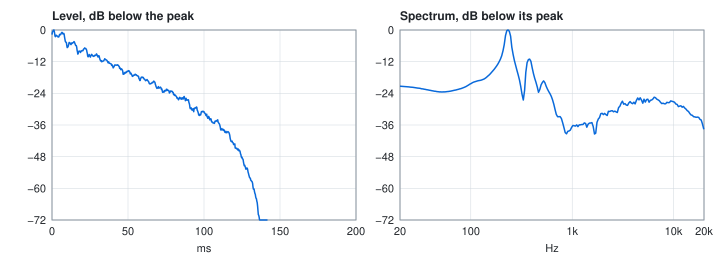

# Halyard

A one-voice snare and clap synthesizer, rendered offline to mono WAV, for
producers who program their drums: house, tech house and trance at its core,
from a drum machine's snare to a drummer's rimshot, cross-stick and brush. It
implements the *Snare/Clap Synth design and implementation plan, revision 5*
([docs/PLAN.md](docs/PLAN.md)): a modal body, up to four layers of one seeded
noise, up to two rims and a brush are summed into one saturator and
band-limited once by a frozen minimum-phase decimator.

    x(t) = b(t) + Σ_j w_j(t) + Σ_k c_k(t) + v(t),    y(t) = S_α(x(t)),    out[m] = p · g · Σ_k h[k] · y((mK − k) / F)

Everything before the decimator is a pure function of time, so a render
depends only on the patch, its seed, the renderer version and the frozen
filter. Each render states whether its aliasing is demonstrated below
−100 dB, by how much, what dominates it and how much more drive it takes to
leave that domain.

The user guide is [docs/GUIDE.md](docs/GUIDE.md): the workflow, every
control, recipes and how to read the report. How the instrument is made, and
what it promises, is [docs/DESIGN.md](docs/DESIGN.md). Hear the fifteen references,
with their figures, reports and patches, in
[docs/references.md](docs/references.md).



## Install

Halyard needs Python 3.12 or later.

```
uv tool install "halyard-synth[audition]"
```

or `pipx install "halyard-synth[audition]"`. The `audition` extra adds live
playback through sounddevice and PortAudio; without it every other command
works. From a checkout, `uv tool install ".[audition]"`; to work on Halyard,
see [CONTRIBUTING.md](CONTRIBUTING.md).

## Use

```
halyard init crack --tune D3 > snare.toml               # a complete starting patch (writes tune_hz = 146.832)
halyard audition snare.toml --watch --bpm 92 --with groove.wav   # on the backbeat, over the track's loop
halyard audition snare.toml --watch --against favourite.wav --blind
halyard render snare.toml --out snare.wav --takes 8      # round-robin takes snare_rr1.wav … snare_rr8.wav
halyard verify snare.toml --takes 8                      # each take against its reference render
halyard extract snare_rr3.wav > take3.toml               # the exact patch of any exported file
halyard tune snare.toml F3 > snare-f3.toml               # retune: modes, glide and rattle follow
halyard stretch snare.toml all 0.8 > tight.toml          # fit every shape to a tempo
halyard init clap > clap.toml
halyard bursts clap.toml 'noise[1]' --count 4 --spacing 11 > clap-4.toml   # a clap train as ordinary knots
halyard softer snare.toml 12 > snare-12.toml             # the same drum struck 12 dB softer
halyard softer snare.toml 24 > snare-24.toml
halyard flam snare.toml --gap 25 > flam.toml             # a grace note 12 dB softer, 25 ms ahead
halyard pack snare.toml snare-12.toml snare-24.toml --takes 6 --out kit/
```

A test runs these commands, all but `audition`, in this order.

The fifteen references are `tone`, `crack`, `fat`, `driven`, `clap` and `snap`,
the genres' `machine`, `house`, `short-clap`, `rim-click`, `big-clap` and
`long-snare`, and the played end's `rimshot`, `cross-stick` and `brush`.
They are matched in loudness (−27 LUFS), peak below −1 dBFS over seeds 1–16,
and every take of them is inside the validated domain with at least 16 dB of
drive headroom. They are starting points: their names never select hidden
algorithms.

Every command is also a Python function; the guide's
[From Python](docs/GUIDE.md#from-python) shows them, in examples a test runs.

The editing commands print a complete, canonical patch and never add a
parameter, so every change is visible and can be edited further. Knots,
layers and modes are numbered from 1, as the parser's messages and the report
number them: `noise[2].amp[3].ms` is the time of the third knot of the second
layer.

## The patch

A patch is a complete TOML description of one hit. Every field is required and
the renderer has no defaults, so a future default can never change an old
patch. The parser rejects anything outside the valid domain and never clamps
or repairs.

```toml
instrument = "snare"
schema = 1
seed = 1

[body]
tune_hz  = 185.0
level_db = -4.0
damping  = 1.0              # mode i decays ratio^damping times faster
modes = [                   # loudest mode exactly 0 dB
  { ratio = 1.0,   level_db = 0.0 },
  { ratio = 1.593, level_db = -5.0 },
  { ratio = 2.136, level_db = -11.0 },
]
pitch = [                   # ratio to tune_hz; starts at 0 ms, ends at 1
  { ms = 0.0,  ratio = 1.08 },
  { ms = 15.0, ratio = 1.0 },
]
amp = [                     # shape: 0 at both ends, highest point exactly 1
  { ms = 0.0,   gain = 0.0 },
  { ms = 0.4,   gain = 1.0 },
  { ms = 25.0,  gain = 0.45 },
  { ms = 90.0,  gain = 0.1 },
  { ms = 180.0, gain = 0.0 },
]

[[noise]]                   # noise[1]
level_db = -10.0
band_hz  = [1500.0, 16000.0]
rattle   = 0.0              # 0 … 1, gated at the body's fundamental
amp = [
  { ms = 0.0,  gain = 0.0 },
  { ms = 0.05, gain = 1.0 },
  { ms = 0.15, gain = 0.7 },
  { ms = 3.0,  gain = 0.1 },
  { ms = 8.0,  gain = 0.0 },
]

[[noise]]                   # noise[2]
level_db = -6.0
band_hz  = [2500.0, 9000.0]
rattle   = 0.5              # 0 … 1, gated at the body's fundamental
amp = [
  { ms = 0.0,   gain = 0.0 },
  { ms = 1.5,   gain = 1.0 },
  { ms = 40.0,  gain = 0.4 },
  { ms = 140.0, gain = 0.08 },
  { ms = 260.0, gain = 0.0 },
]

[drive]
db = 6.0                    # small-signal gain; 0 = bypass

[output]
sample_rate = 48000
format      = "float32"     # "float32" | "pcm24" | "pcm16"
mode        = "gain"        # "gain" | "peak" | "true-peak"
db          = -6.0          # gain in dB, or peak target in dBFS
polarity    = 1
```

In brief:

- **Body.** One to four modes at fixed ratios of `tune_hz`, all following one
  pitch glide. With `damping` β, mode i plays the body shape's decay r_i^β
  times faster from the peak on.
- **Noise layers.** Every layer uses the same seeded noise, weighted by its
  own band. Identical bands give identical noise, a crossfade between two
  layers is a spectral morph, and editing a band reweights the same noise
  instead of rerolling it. `rattle` gates a layer at the body's fundamental,
  glide included, as snare wires slap the head.
- **Rims.** Up to two `[[rim]]` tables, or none: the hoop's ring and the
  stick's knock, up to eight modes each at their own frequencies in Hz, which
  the tuning and the glide leave alone. A rimshot puts one over the head; a
  cross-stick is a rim almost alone.
- **Brush.** One `[[brush]]`, or none: a noise layer whose band moves by a
  sweep of up to an octave, as one noise filtered rather than a crossfade.
- **Drive.** `drive.db` is the saturator's small-signal gain on the sum; 0 dB
  is exact bypass.
- **Seed.** Each seed is a take of the same sound. `--takes N` renders seeds
  seed, seed + 1, … as round robins that share one gain.

The valid domain:

| Quantity | Valid range |
|---|---|
| `tune_hz` | 40 – 4,000 |
| modes | 1 – 4; the first ratio exactly 1; strictly increasing, ≤ 8 |
| mode levels | −60 – 0 dB, with the loudest exactly 0 |
| body frequency f₀·r_i·r(t) at every pitch knot | 10 Hz – 20 kHz |
| `damping` | 0 – 3 |
| body and layer `level_db` | −inf (silence), or −90 – +24 |
| noise layers | 1 – 4 |
| `band_hz` | 20 ≤ low < high ≤ 20,000 |
| `rattle` | 0 – 1 |
| drive | 0 – 48 dB |
| knots per curve | pitch 2 – 32, amplitude 3 – 32 |
| knot spacing | ≥ 10 µs (compared on the decimal values as written) |
| body curves / noise curves | end by 2 s / by 1 s |
| output | 44.1, 48, 88.2 or 96 kHz; float32, pcm24 or pcm16; gain −60 – +24 dB; sample or true peak target −60 – 0 dBFS |
| `seed` | 0 – 2⁶³ − 1, takes included |
| rims | 0 – 2, each 1 – 8 modes in 100 Hz – 20 kHz, strictly increasing, the loudest exactly 0 dB; `damping` 0 – 3, the highest mode decaying at most 512 times faster than the first; shape by 2 s |
| brush | 0 – 1; a layer's fields, its shape by 1 s; `sweep` 2 – 32 knots by 1 s, ratios 0.5 – 2 and an octave apart at most, both band edges within 20 Hz – 20 kHz |

## What a render reports

```
tuning   185.000 Hz, F#3 +0.0 cents; modes 185.0, 294.7, 395.2 Hz
length   260.0 ms source, 261.9 ms exported (12571 samples at 48000 Hz, float32), seed 1
peak     -4.05 dBFS sample, -3.72 dBTP true
loudness -19.0 LUFS, the largest 400 ms momentary loudness (BS.1770)
domain   inside the validated domain: predicted aliasing -137 dB, margin 37.0 dB
         mostly kinks, 64% at noise[1].amp[2] (0.05 ms); drive headroom +21.5 dB
render   86 ms
```

The domain line is the renderer's own prediction of its aliasing error,
relative to the output peak; inside means at most −100 dB. The line under it
says what dominates the prediction (saturation, or the kinks with the knot
that contributes most) and how much more drive the take stands before its
status changes. Outside, the headroom is negative and the line says what to
lower `drive.db` to. For several takes the report gives each take's own
judgement, the loudness and peak spread, and flags a set whose loudness
spreads over more than 1 dB. GUIDE.md explains every line.

## How it renders

- **Rates.** The internal rate is 32× the base rate: 1.4112 MHz for the
  44.1 kHz family, 1.536 MHz for 48 kHz. The 88.2 and 96 kHz exports reuse
  their family's rate and filter with factor 16, so a 96 kHz file equals the
  48 kHz file with the in-between samples filled in, bit for bit.
- **Decimator.** One frozen minimum-phase FIR per family, passing 0–20 kHz
  within 0.001 dB and attenuating at least 110 dB from base/2 up. It ships
  as data with a SHA-256 checksum, so the sound cannot drift with SciPy
  versions.
- **Evaluation.** The internal signal is computed in blocks of 2¹⁶ samples
  aligned to the trigger, each source only over its own support, with curves
  evaluated segment by segment. A longer render never changes earlier
  samples. The noise tables of a render's layers are computed in parallel and
  cached; decimation runs in parallel chunks that are bit-identical to one
  `upfirdn` call.
- **Output.** One gain for the whole set (the output gain, or in peak or
  true-peak mode the gain that brings the loudest take's sample or true peak
  to the target), then polarity, then
  one conversion to float32, or one quantization to PCM with seeded TPDF
  dither that leaves exact zeros alone.
- **File.** `fmt`, `fact` (float), `smpl` with the root key (left out when
  the body is silent), a private `snar` chunk with the take's own patch text,
  its seed and gains, the renderer version, the decimator checksum and the
  dependency versions, and `data`.

## Development

```
uv run pytest                                    # the full suite (about a minute)
uv run python -m tools.design_decimator --check
uv run python -m tools.grid run --k 32 --workers 6  # the adversarial grid, about 10 minutes; a brush's
                                                    # references hold up to seven tables of 98–197 MB, so 6 fit in 16 GB
uv run python -m tools.grid analyze docs/grid/k16.csv docs/grid/k32.csv
uv run python -m tools.headroom run --dense      # the report's drive headroom against full renders (about 20 minutes on 12 cores)
uv run python -m tools.headroom analyze docs/grid/headroom.csv
uv run python -m tools.references                # the fifteen references over seeds 1–16
uv run python -m tools.bench                     # render time and memory on this machine
uv run python -m tools.sfz_players prepare DIR   # a pack and notes; then tools/sfz_players.sh DIR (Docker)
uv run python -m tools.sfz_players check DIR     # and what sfizz and liquidsfz played
uv run python -m tools.golden                    # regenerate golden renders (a deliberate sound change only)
uv run python -m docs.build                      # the figures, sounds and gallery in docs/, from the code
uv run python -m docs.build --check              # what is out of date (a test checks it too)
```

[docs/VALIDATION.md](docs/VALIDATION.md) records every numerical criterion of
the plan with its measured value, the adversarial grid, the choice of K, the
refit of the validated-domain rule and performance.
[docs/BENCHMARK.md](docs/BENCHMARK.md) is the protocol for the
sample-replacement benchmark.

| Module | Responsibility |
|---|---|
| `src/halyard_synth/patch.py` | schema, parsing, validation, canonical TOML; `tune`, `stretch`, `bursts`, `softer`, `flam`; tuning helpers |
| `src/halyard_synth/curve.py` | Hermite curves, PCHIP slopes, exact integrals, knot jumps, decay compression |
| `src/halyard_synth/noise.py` | seeded noise, coherent layer tables (cached), values and slopes between samples, seeded dither |
| `src/halyard_synth/voice.py` | modal body, noise layers with rattle, rims, the brush's blend, drive; knee slew at every drive, kink bound |
| `src/halyard_synth/render.py` | rates, frozen decimators, parallel decimation, domain rule and drive headroom, takes, report, export |
| `src/halyard_synth/loudness.py` | BS.1770 K-weighting at every rate, momentary loudness |
| `src/halyard_synth/pack.py` | velocity layers, takes, one gain per pack, the SFZ mapping |
| `src/halyard_synth/reference.py` | the reference renderer and comparison behind `halyard verify` |
| `src/halyard_synth/wav.py` | RIFF writing and reading, float and PCM |
| `src/halyard_synth/audition.py` | hits on the beat grid, patches and takes cycling, beds, A/B and blind order, watching, playback |
| `src/halyard_synth/cli.py` | commands |
| `src/halyard_synth/data/` | frozen decimators and checksums, the fifteen references |

## Status

| Milestone | State |
|---|---|
| 1. Complete path | Done. Every §8.1 criterion that does not need the grid passes (VALIDATION.md). |
| 2. Measure and freeze | Done. K = 32, the rule's constant (0.54) and the decimators are frozen from an adversarial grid, now 1,417 fixtures at 32× (K chosen on the first 957 at 16× and 32×); the drive headroom is checked on every fixture; golden renders begin. |
| 3. Audition and delivery | Done here with a simulated device: exact buffers, stale renders dropped, swaps at hit boundaries, patches and takes cycling, the bed on the grid. Packs parse back from their SFZ with the right velocity and take mapping. Packs play as mapped in sfizz and liquidsfz, built from source in a throwaway container (VALIDATION.md). Playing through a real device needs you. |
| 4. Voicing | By measurement: the references are loudness-matched, inside with 16 dB or more of drive headroom for seeds 1–16, and every usability task moves its measurement the right way. Approval by ear, in context and across takes and strengths, needs you. |
| 5. Benchmark | Protocol written (BENCHMARK.md); it needs your samples and your ears. |

## License

Halyard is free software, under the [GNU General Public License](LICENSE),
version 3 or later.

The sounds you make with it are yours. An additional permission in
[NOTICE](NOTICE) lets you use the sounds Halyard renders, the patches and
SFZ maps it writes, and its reference patches under any terms you choose, in a
track or in a sample pack you sell.
