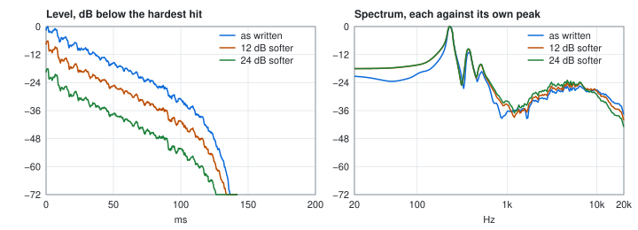

# How Halyard is made

This page describes the instrument as it is, for the people who use it: what
makes its sound, what it promises and why. The user guide ([GUIDE.md](GUIDE.md))
says how to play it; the plan ([PLAN.md](PLAN.md)) is the design record the
code cites, revision by revision; the validation record
([VALIDATION.md](VALIDATION.md)) holds the measurements.

## Who it is for

Halyard is for producers who program their drums: house, tech house and
trance at its core, where the kick leads and the snare or clap answers it on
the backbeat. Their snares run from a drum machine's, two tuned tones and a
hiss, to a drummer's, a rimshot, a cross-stick or a brush, and a track often
wants a sound somewhere between. So the instrument is built along that line:
the same few physical controls make the programmed end and the played end,
and its fifteen references ([references.md](references.md)) mark the way.

It renders offline, to WAV files and SFZ kits that a DAW or a sampler plays.
It is not a plugin: a render takes from under a tenth of a second to about a
third, at most, and the time goes into making the sound exact and saying so.

## What makes the sound

One hit is a sum of sources into one saturator:

- **The body** is the drum's head: up to four modes at fixed ratios of the
  tuning, the ideal membrane's 1, 1.593, 2.136 and 2.295 to start from. They
  share one pitch glide, because a head struck hard is tighter for a moment
  and every mode rises with it, and `damping` makes the higher modes die
  first, as on a real head. A single high mode is a ping: a snap, or a drum
  machine's click.
- **The noise layers**, up to four, are one seeded noise seen through
  different bands. Because they are the same noise, two layers never thin
  each other out, a crossfade between them is a filter that moves, and
  editing a band reweights the noise you hear instead of rolling a new one.
  A short wide layer is the stick; a longer one is the wires, which `rattle`
  gates at the body's fundamental, as snare wires slap the head that drives
  them.
- **The rims**, up to two, are what a stick on the hoop adds: modes at their
  own frequencies, which the tuning and the glide leave alone, because a hoop
  and a stick have no harmonic relation to the head. A rimshot puts a rim
  over the head; a cross-stick is a rim almost alone.
- **The brush** is a layer whose band moves while it sounds, by a sweep of up
  to an octave, as bristles drawn across a head do. It is the same noise
  filtered, blended across third-octave copies of its band, so the band keeps
  its shape as it moves ([GUIDE.md](GUIDE.md#brush)).
- **The drive** is a saturator on the sum, its small-signal gain in dB. It
  makes a snare dense and is where most of the aliasing a render could have
  comes from, so it is the control the report watches most.

Every change of level over time is a curve of knots you write, with no hidden
envelope: what the patch says is what you hear. Claps are written the same
way, `halyard bursts` turning a layer into a train of bursts as ordinary
knots, and so are flams, `halyard flam` writing a softer grace note before
the main stroke.

## Struck softer

A drum hit softer is not the same hit turned down: it is darker, its pitch
glides less and its attack is softer. `halyard softer` writes that patch from
three physical rules, so velocity layers are the same drum at different
strengths ([GUIDE.md](GUIDE.md#editing-commands)):

- every source falls by the same dB, before the drive, so a softer hit is also
  cleaner;
- the glide shrinks with the square of the amplitude, as tension modulation
  does;
- every attack lengthens and every upper band edge falls with the fifth root,
  Hertz's law of contact: a softer strike stays longer on the head and
  excites less of the top.

## What it promises

- **Exactly the same file, every time.** A render depends only on its patch
  and its seed: the noise is drawn from a cryptographic hash of the seed, the
  filters are frozen data with checksums, and every file carries the patch
  that makes it again (`halyard extract`). Across machines and library
  versions, files agree to a millionth of full scale.
- **Aliasing measured, not hoped for.** Synthesis runs at 32 times the
  sample rate and is band-limited once by a frozen filter. Every render then
  states whether it lies where its aliasing is demonstrated below −100 dB,
  what dominates it, and how much more drive it would take to leave. That
  judgement comes from a rule fitted on an adversarial grid of 1,441
  fixtures, which never finds an error inside the domain above −110 dB, and
  `halyard verify` measures any render against a reference rendered far
  above the sample rate.
- **Takes that sound like one drum.** Each seed is a take of the same sound.
  Takes share one gain so their natural differences stay, and a pack puts
  them in round robins under velocity layers on a square law, which two SFZ
  players play exactly as written.
- **Files that start and end clean.** Every file starts at exactly zero at
  the strike and ends in its own decaying tail, at a level you set by gain,
  sample peak or true peak, and nothing is ever clipped: an over is refused,
  with the reduction it needs.

## What it leaves out

Halyard models the sound of a hit, not a drum: it does not simulate wire
physics, a shell, a stick's position or a room. Its rimshots, cross-sticks
and brushes are synthesized, like the rest. Rolls, reverb and processing
chains such as gated reverb belong in the DAW, and so does stereo width:
two takes panned apart widen a snare's noise while its body stays centred.
