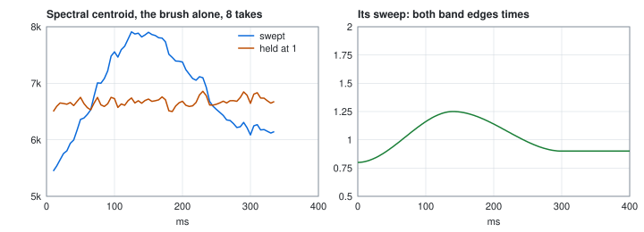
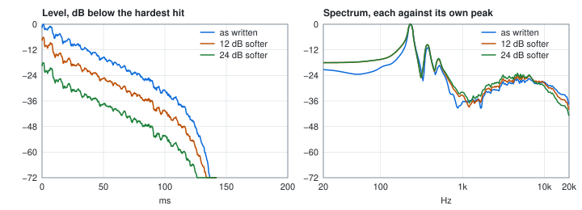
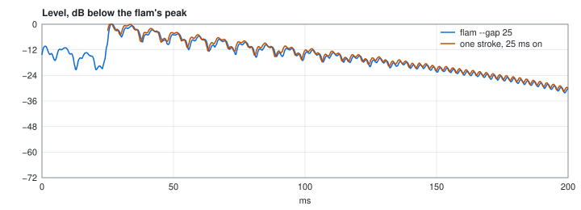

# User guide

This guide is for producers and sound designers who program snares and claps.
It covers the workflow, every control, recipes for common edits, and how to
read what a render reports. The design and its evidence are in
[PLAN.md](PLAN.md) and [VALIDATION.md](VALIDATION.md).

## The workflow

1. **Start from the nearest reference.** `halyard init crack --tune D3 > snare.toml`.
   The references are `tone`, `crack`, `fat`, `driven`, `clap` and `snap`
   (below). `--tune` takes a note name or a frequency; the patch stays in Hz.
2. **Voice it in context.** `halyard audition snare.toml --watch --bpm 92 --with groove.wav`
   plays the snare on beats 2 and 4 over your loop and re-renders every time
   you save the file. Edits take over at the next hit.
3. **Match it against the sample it should replace.** `halyard audition snare.toml --watch --against favourite.wav --blind`
   alternates your render with the sample, matched in loudness, in a random
   order that audition reveals when you stop it.
4. **Derive softer layers.** `halyard softer snare.toml 8 > snare-8.toml`, and so on.
5. **Pack them with takes for the sampler.** `halyard pack snare.toml snare-8.toml snare-16.toml snare-24.toml --takes 6 --out kit/`.

Every file is exact and reproducible: `halyard extract` gives back the exact
patch of any exported file, take included.

## The references

| Reference | What it is | Try |
|---|---|---|
| `tone` | Two tonal modes and a soft click over bright, snappy noise; round and clearly pitched | tuning, damping, the second mode's level |
| `crack` | A quick glide, a sharp click and bright wires with a short decay; tight | the stick's level and rise, `stretch` |
| `fat` | A lower tuning, a longer body, buzzing wires and a tail that darkens | rattle, the dark layer's band and length |
| `driven` | Body and noise saturated together; dense, still pitched | drive, the wires' level |
| `clap` | Four bursts and a diffuse tail, with no body | `bursts`, the bands, the tail layer |
| `snap` | A short, bright burst over a high ping that dies fast; a finger snap or rim click | the ping's tuning, the burst's band |
| `machine` | Two tuned tones and a hiss, no wires and almost no glide; the programmed end | the second mode's ratio and level, the hiss's length |
| `house` | A punchier drum-machine snare, its tone gliding a little under a bright noise that outlasts it | drive, the glide, the noise's length |
| `short-clap` | Three tight bursts and a short tail, dry; tech house | `bursts`, the tail layer |
| `rim-click` | Two short pings and a tick, no head; the machine's rimshot | the rim's two frequencies, `stretch` |
| `big-clap` | Two trains in different bands, staggered, over a long diffuse tail; trance | the trains' `--start` and bands, the tail |
| `long-snare` | Wires that buzz out past half a second, for builds; trance | the wires' length and rattle, drive |
| `rimshot` | The hoop ringing over a hard hit on the head | the rim's level and damping |
| `cross-stick` | The stick's shoulder knocking the rim, the head barely moving | the rim's damping and frequencies, the body's level |
| `brush` | A swish across the head, the wires answering, under a soft tap | the sweep's knots, `stretch brush[1].sweep` |

They are matched in loudness (−27 LUFS) so you can compare them fairly, and
they peak below −1 dBFS. Raise `output.db` as you need. Hear each one, with
its figure, its report and its patch, in [the gallery](references.md).

## Every control

A patch is complete: every field is required, and the renderer has no
defaults. Paths below are the ones the parser and the report use. They count
from 1: `noise[2].amp[3]` is the third knot of the second layer.

### Times and curves

Knot times are milliseconds from the hit. Knots must be at least 10 µs apart.
Every curve is a smooth monotone cubic through its knots (PCHIP): it never
overshoots between knots, so an amplitude shape stays within 0 … 1 and the
pitch is extreme only at its knots.

- **Amplitude shapes** (`body.amp`, `noise[N].amp`) start and end at gain 0,
  and their highest point is exactly 1. Levels are set separately, in dB.
- **Knots every 10 dB** of a decay reproduce an exponential tail within
  0.15 dB. The first segment after a peak starts flat, because the peak has
  zero slope, and that rounds the top of a decay by 1–5 dB. For a crack, put a
  **shoulder knot** within about 0.1 ms after the peak, as the references and
  `bursts` do.
- **Every knot is a kink.** Very fast segments under loud noise alias. The
  report tells you when a knot matters and which one.

### Body

| Field | Range | What it does |
|---|---|---|
| `tune_hz` | 40 – 4,000 | The settled frequency of the first mode. Up to 4 kHz, so a snap or rim click can be a single high ping. |
| `level_db` | −inf, −90 – +24 | The body's level. `-inf` silences it: the body then still gates rattle, but never lengthens the file. |
| `damping` | 0 – 3 | Mode i decays ratio_i^damping times faster than the fundamental, from the body's peak on. 0: all modes decay together. |
| `modes` | 1 – 4 | `{ ratio, level_db }`. The first ratio is exactly 1; ratios increase strictly and stay ≤ 8. The loudest mode is exactly 0 dB: mode levels are a spectral shape, the body's level is its gain. The ideal membrane gives 1, 1.593, 2.136 and 2.295. |
| `pitch` | 2 – 32 knots | A ratio to `tune_hz`, starting at 0 ms and ending at 1. Every mode follows it: tension modulation raises every mode of a head together. |
| `amp` | 3 – 32 knots | The body shape. Its first knot at gain 1 is the peak, where damping starts. |

Every body frequency, f₀ · ratio · glide, must stay within 10 Hz – 20 kHz at
every pitch knot. `halyard tune` refuses a tuning that would take a mode out of
that range; it never clamps.

### Noise layers

One to four `[[noise]]` tables. Every layer uses the same noise, weighted by
its own band, so layers are coherent: identical bands give identical noise,
two identical layers at equal level sum to +6 dB, and a crossfade between two
layers is a spectral morph of one noise.

| Field | Range | What it does |
|---|---|---|
| `level_db` | −inf, −90 – +24 | The layer's level. |
| `band_hz` | 20 ≤ low < high ≤ 20,000 | Second-order skirts, half power at the edges. Editing the band reweights the same noise. |
| `rattle` | 0 – 1 | Gates the layer at the body's fundamental, following its glide, while the body shape sounds: snare wires. 0 is off, 1 is full depth. |
| `amp` | 3 – 32 knots | The layer's shape; it ends by 1 s, because the noise repeats every second. |

A typical snare has a short, wide **stick** layer (the click) and a longer
**wires** layer, and perhaps a darker, longer layer so the tail darkens.
Layers are how the noise changes colour over time: a bright, short layer over
a darker, longer one.

### Rims

Up to two `[[rim]]` tables, or none: the rim struck with the head, as in a
rimshot, or instead of it, as in a cross-stick. A rim rings at its own
frequencies, in Hz, for a hoop and a stick have no harmonic relation to the
head: it ignores `tune_hz` and the glide, and never rattles the wires.

| Field | Range | What it does |
|---|---|---|
| `level_db` | −inf, −90 – +24 | The rim's level. |
| `damping` | 0 – 3 | Mode i decays (hz_i / hz_1)^damping times faster than the first, from the rim's peak on; at most 512 times, as fast as a body mode can, or the patch is refused. |
| `modes` | 1 – 8 | `{ hz, level_db }`, from 100 Hz to 20 kHz, strictly increasing, the loudest exactly 0 dB. |
| `amp` | 3 – 32 knots | The rim's shape, within 2 s. |

A **rimshot** is a body and its wires with a loud, short rim on top, a few
modes between 1 and 10 kHz; a **cross-stick** is the rim alone, or with a
quiet body and no wires, its modes lower and its shape a few milliseconds
long. `halyard softer` lowers a rim's level and lengthens its rises like the
others'; `halyard stretch` names its shape `rim[1].amp`.

### Brush

One `[[brush]]` table, or none: a noise layer whose band moves during the hit,
as wire bristles sweep across a head. It has a layer's fields, and a sweep:

| Field | Range | What it does |
|---|---|---|
| `level_db` | −inf, −90 – +24 | The brush's level. |
| `band_hz` | 20 ≤ low < high ≤ 20,000 | The band at sweep ratio 1. |
| `rattle` | 0 – 1 | As a layer's: the wires answer a brush too. |
| `sweep` | 2 – 32 knots | `{ ms, ratio }`, within 1 s: both band edges times the ratio, 0.5 – 2, an octave between the lowest and the highest at most. Held before its first knot and after its last, which it leaves and reaches smoothly. |
| `amp` | 3 – 32 knots | The brush's shape, within 1 s. |

The band stays within 20 Hz – 20 kHz at every ratio, or the patch is refused.
The moving band is one noise filtered, not a crossfade of noises: it keeps the
written band's shape to within 0.5 dB and its level to within 0.1 dB all along
the sweep. A **sweep** is a long, slow brush rising and falling through a few
semitones; a **swish** is a shorter one with a quicker sweep; a brush **tap**
is a short layer, needing no sweep. `halyard stretch` names the sweep
`brush[1].sweep` and stretches it from 0 ms; `halyard softer` treats the brush
as a layer and leaves its sweep alone.



### Drive

`drive.db`, 0 – 48 dB, is the small-signal gain of a tanh saturator on the sum
of everything. 0 dB is exact bypass. On noise, what matters is **noise level +
drive**: a layer at −6 dB with 24 dB of drive saturates like one at 0 dB with
18 dB.

### Output

| Field | Values | What it does |
|---|---|---|
| `sample_rate` | 44100, 48000, 88200, 96000 | The file's rate. The 96 kHz file is exactly the 48 kHz one with samples filled in. |
| `format` | `float32`, `pcm24`, `pcm16` | PCM uses the plain PCM tag that hardware samplers read, with seeded triangular dither that leaves exact zeros alone. |
| `mode` | `gain`, `peak`, `true-peak` | Apply `db` as a gain, or scale so the sample peak, or the true peak, is at `db` dBFS. |
| `db` | gain −60 – +24; peak −60 – 0 | See `mode`. |
| `polarity` | 1, −1 | Inverts the output. |

A gain-mode render over full scale is refused, with the reduction it needs;
`--allow-over` writes it anyway as a float file. Nothing is ever clipped. A
PCM render must peak 2 LSB below full scale so the dither never clips; peak
mode lowers its target by those 2 LSB. The true peak is the largest value of
the file's band-limited reconstruction, the level a converter reaches between
the samples, measured exactly from the render; use `true-peak` when a
limiter or a streaming target counts in dBTP.

### Seed and takes

`seed` picks the noise. The noise is the instrument, so each seed is a
**take** of the same sound, slightly different, as real hits are.
`halyard render … --takes 8` writes seeds seed, seed + 1, … as
`snare_rr1.wav` … `snare_rr8.wav`. The takes of a set share one gain: in peak
mode, the gain that brings the loudest take to the target. The others keep
their natural levels, because takes differ more in peak (1.5–7 dB) than in
loudness (0.05–3 dB). For sounds whose takes vary a lot, such as short snaps,
`--level-match` scales each take to the loudness of the first; the report
flags any set whose loudness spreads over more than 1 dB.

## Editing commands

Each prints a complete patch; redirect it to a file. They rewrite points and
never add parameters, so you can always keep editing the result by hand. They
fail, and say why, rather than clamp.

- **`halyard tune PATCH NOTE`** sets `tune_hz` from D3, F#3, Eb4 or a frequency
  in Hz. Modes, glide and rattle follow, being ratios.
- **`halyard stretch PATCH CURVE... FACTOR [--after MS]`** rescales knot times
  after each shape's peak (0 ms for pitch), or after `--after`. `all` names
  every amplitude shape, so `halyard stretch snare.toml all 0.8` shortens a whole
  sound; `--after 0` also scales the rises, which tightens a clap.
- **`halyard bursts PATCH LAYER --count N --spacing MS …`** rewrites a layer's
  shape as a clap train: N bursts (1–10), each rising in `--rise` ms (default
  0.1) to its peak, a shoulder 0.1 ms after, and down to `--dip` (default 0.1,
  over the lower of the two peaks) before the next. Each gap is `--growth`
  times the previous; peaks follow `--taper` with the loudest exactly 1; the
  last burst decays over `--tail` ms (default 80) with a knot 20 dB down a
  third of the way. `--start MS` delays the first burst, so two layers with
  different bands and starts make a stacked clap.
- **`halyard softer PATCH DB [--glide P] [--contact P]`** gives the same drum
  struck DB softer, by three rules from the physics of a struck head:
  - every source level falls by DB, before the drive, so a softer hit is also
    cleaner;
  - the glide's excess over 1 scales by v^glide (default 2: tension modulation
    follows the vibration's energy), with v = 10^(−DB/20);
  - every rise lengthens by v^(−contact) and every layer's upper band edge
    scales by v^contact (default 0.2: Hertz's contact law, a slower strike
    excites less high end).

  At 12 dB softer, a 1.08 glide becomes 1.005, a 0.05 ms rise 0.066 ms and a
  16 kHz edge 12.1 kHz. An exponent of 0 turns its rule off. `softer` by a then
  b equals `softer` by a + b up to the decimals it writes.

  
- **`halyard flam PATCH --gap MS [--grace DB] [--glide P] [--contact P]`**
  strikes the drum twice: a grace note `--grace` dB softer (default 12), by
  `softer`'s rules, then the main stroke `--gap` ms later. Every shape is the
  grace's until the main stroke starts, takes the grace's value there, and
  goes on as the main stroke's; the glide restarts at the main body's peak.
  The two strokes share their bands and a brush's sweep, and the grace's
  higher modes decay with its fundamental. A flam of 15–40 ms suits most
  tempos; it fails rather than drop knots when a shape would need more than
  32 or run past its limit.

  

## Recipes

These start from a reference and take at most three field edits or one
command; the test suite checks that each moves the sound the right way.

| To | Edit |
|---|---|
| Change the tuning | `halyard tune snare.toml F3`, or edit `body.tune_hz` |
| Shorten the tail | `halyard stretch snare.toml all 0.7` |
| Add crack | raise the stick layer's `level_db` (the short, wide layer) by 4–6 dB, or shorten its rise |
| Add body | raise `body.level_db` |
| Add wires | raise the wires layer's `level_db` and its `rattle` |
| Darken | lower each layer's upper band edge (`band_hz[2]`) |
| Add aggression | raise `drive.db` by 6 and lower `output.db` to taste. In a driven sound, the edge lives in the saturated source: raising the stick adds less than in a clean one. |
| Make a ghost note | `halyard softer snare.toml 18` |
| Play a flam | `halyard flam snare.toml --gap 25` |
| Tighten a clap | `halyard stretch clap.toml all 0.7 --after 0`, or re-run `bursts` with a shorter `--spacing` |
| Darken a clap | lower both edges of each layer's band |
| Shorten or brighten a snap | `halyard stretch snap.toml all 0.6`; raise the burst's band and level |
| Move a snap's ping | edit `body.tune_hz` |

**Pitched buzz.** Rattle reads the body's shape and phase, not its level, so a
silent body can still gate a layer: a buzz at a pitch with no tone of its own.

## Reading the report

```
tuning   185.000 Hz, F#3 +0.0 cents; modes 185.0, 294.7, 395.2 Hz
length   260.0 ms source, 261.9 ms exported (12571 samples at 48000 Hz, float32), seed 1
peak     -4.05 dBFS sample, -3.72 dBTP true
loudness -19.0 LUFS, the largest 400 ms momentary loudness (BS.1770)
domain   inside the validated domain: predicted aliasing -137 dB, margin 37.0 dB
         mostly kinks, 64% at noise[1].amp[2] (0.05 ms); drive headroom +21.5 dB
render   86 ms
```

- **tuning** is `tune_hz` as a note and cents, and each mode's settled
  frequency.
- **length** is the source length (the latest end among the audible sources'
  shapes: silent sources never lengthen a file) and the exported length, which
  includes the decimator's decaying tail. Every file starts at exactly zero and
  ends in that tail, so a sampler needs no fades.
- **peak** is the sample peak and the true peak: the crest of the output's
  band-limited reconstruction, measured exactly, as `output.mode = "true-peak"`
  targets it.
- **loudness** is the largest K-weighted 400 ms momentary loudness over every
  window position (ITU-R BS.1770), in LUFS. Short sounds read low, because the
  window spreads their energy over 400 ms.
- **domain** is the renderer's own prediction of its aliasing error, relative
  to the peak. Inside means at most −100 dB: the grid has demonstrated that
  every render inside measures below −100 dB (VALIDATION.md). Outside, the
  render is still defined and exact, but unvalidated; `halyard verify` measures
  its actual error against a reference render.
- **The line under it** says what dominates the prediction:
  - *mostly kinks, 64% at noise[1].amp[2] (0.05 ms)*: a fast segment around
    that knot under a loud carrier. Lengthen the rise around it, or lower that
    layer.
  - *mostly saturation*: the drive on a loud, bright source. Lower the drive,
    the level, or the layer's upper band edge.

  The **drive headroom** is how much more drive the take stands before its
  status changes. Outside, it is negative and the line says what to lower
  `drive.db` to. It is exact or cautious, never optimistic. Margin and
  headroom differ: near the edge the prediction moves 11–12 dB per dB of
  drive, so a large margin can mean little headroom.
- **takes** (with `--takes`): the set gain, the loudness and peak spread, and
  each take's own levels and domain status. Each take is judged on its own
  render.

## Audition

`halyard audition PATCH... [--watch] [--bpm BPM] [--beats 2,4] [--with BED] [--against SAMPLE] [--blind] [--takes N]`

- It plays exactly the buffer `render` writes; PCM formats add only their
  quantization. It opens the device at the patch's sample rate and never
  resamples.
- `--watch` re-renders on every save. Each edit is a numbered generation;
  stale renders are dropped, an invalid edit keeps the last valid buffer
  playing, and a new buffer takes over at the next hit.
- Without a tempo, hits repeat every rendered length plus 0.5 s. With
  `--bpm`, they land on beats 2 and 4 of each 4/4 bar, tails overlapping;
  `--beats 1,2,3,4` hits every beat (a clap), `--beats 3` is half time.
- `--with BED` loops a bed under the hits. It must be at the patch's rate and
  within 1 ms of a whole number of bars; it restarts on the tempo grid, so it
  never drifts. A stereo bed opens a stereo stream with the snare centred.
- `--against SAMPLE` alternates the render with a sample, hit by hit, the
  sample matched to the render's loudness and rematched on every re-render.
  With `--blind` each pair plays in random order, revealed when you stop.
- Several patches cycle hit by hit (velocity layers, or A/B), and `--takes N`
  cycles takes. The first plays as soon as it is ready; the others render
  behind it.
- It warns when the matched sample, or the hits over the bed, would clip the
  device.

## Packs

`halyard pack PATCH... --out DIR [--takes N] [--key K] [--level-match]` renders
a multisample: each patch is one velocity layer, loudest first, and each gets
N takes (take j of a layer plays its seed + j − 1).

- The layers must share their output settings, and their loudness must fall
  from each layer to the next.
- Every file of the pack shares one gain, so the layers keep their natural
  levels.
- Files are named `<stem>_v<top velocity>_rr<take>.wav`, so they also map by
  hand in samplers without SFZ.
- `<stem>.sfz` maps them. Velocity follows a square law, 40·log₁₀(v/127) dB:
  each layer sits where the law reaches its loudness relative to the loudest,
  neighbours meet halfway in dB, and each layer's group carries a curve point
  at every velocity in its range, so the level follows the law across layer
  boundaries. Takes cycle in sequence; the drum never transposes. The key
  defaults to 38, the General MIDI snare, or 39, the hand clap, when no layer
  has a body.
- The pack report lists each layer's loudness, velocity range, take spread and
  domain status.

Neighbouring layers more than 12 dB apart need a group volume above +6 dB,
which some players cap; the pack report says so.

## In a DAW

**One-shots.** Drop a rendered WAV on a drum sampler's pad or a sampler's
key, set to one-shot, with no loop and no fades. Every file starts at exactly
zero at the strike and ends in its own decaying tail, so the sampler needs
neither a start offset nor a fade. The `smpl` chunk names the root key, the
body's tuning as a note, so a sampler that reads it plays the drum at its
pitch on that key; a sound without a body has none. `halyard render --takes
N` writes takes `_rr1` … `_rrN` that share one gain: load them as round robins
or random alternatives, and repeated hits stop sounding like a machine gun.

**Formats.** DAWs read `float32`; `pcm24` and `pcm16`, with seeded dither,
are for hardware samplers and older software. A render over full scale is
refused in any format, with the reduction it needs, and nothing is ever
clipped: lower `output.db`, use a `peak` or `true-peak` target, or pass
`--allow-over` for a float file that keeps the overs.

**Kits.** `halyard pack` writes an SFZ file that any SFZ player loads, with
its WAVs beside it: the velocity layers, the round robins and the square law
are in the mapping. sfizz and liquidsfz, two SFZ players built from source,
play a pack as mapped (VALIDATION.md). A sampler that does not read SFZ maps
the files by their names, `<stem>_v<top velocity>_rr<take>.wav`: the velocity
range of each layer is in the pack report.

**Levels.** The references sit at −27 LUFS so they compare fairly; raise
`output.db` or set `output.mode = "peak"` with a target for a working level,
and keep one gain per kit, as `pack` does, so its layers keep their natural
levels.

## From Python

Everything the commands do is a function of the package, `halyard_synth`.
Patches are frozen dataclasses that check themselves when made, so an edit
that leaves the valid domain raises `PatchError` with every problem's path,
as the parser does. These examples run as a test, in order.

```python
from pathlib import Path

from halyard_synth import patch, render
from halyard_synth.cli import reference_text

p = patch.loads(reference_text("rimshot"))  # or patch.load("snare.toml")
audio, report = render.render(p)  # float32 at the patch's rate, and the report halyard render prints
assert report.inside
print(report)
```

The editing commands are functions from patch to patch, and `dumps` writes
the canonical text they print:

```python
ghost = patch.softer(p, 18)  # the same drum struck 18 dB softer
flammed = patch.flam(p, 25.0)  # a grace note 12 dB softer, 25 ms ahead
lower = patch.tune(p, "D3")
clap = patch.bursts(patch.loads(reference_text("clap")), "noise[1]", patch.Train(4, 11.0))
Path("ghost.toml").write_text(patch.dumps(ghost), encoding="utf-8")
assert patch.load("ghost.toml") == ghost
```

Takes, each written with its patch and provenance as `halyard render` writes
them, and checked against the reference render as `halyard verify` does:

```python
from halyard_synth import reference

audio, report = render.render_takes(p, 4)  # seeds 1-4, one gain for the set
for a, take in zip(audio, report.takes, strict=True):
    render.export(f"rimshot_rr{take.number}.wav", a, p, report, take)
assert reference.verify(p, takes=2).passed
```

A pack, as `halyard pack` writes it, from patch files. It renders in worker
processes, which start by importing your script, so a script that packs needs
Python's usual guard, or every worker would pack again:

```python
from pathlib import Path

from halyard_synth import pack, patch
from halyard_synth.cli import reference_text


def main() -> None:
    p = patch.loads(reference_text("rimshot"))
    names = []
    for db in (0, 12, 24):
        names.append(f"rimshot-{db}.toml")
        Path(names[-1]).write_text(patch.dumps(patch.softer(p, db)), encoding="utf-8")
    assert pack.pack(names, "kit", pack.Options(takes=2)) == 0


if __name__ == "__main__":
    main()
```

## Outside the family

Acoustic snares, whose sound depends on wire physics, shell, stick position
and room; rolls; processing chains such as gated reverb; and stereo width are
outside the model. The rimshot, the cross-stick and the brush are synthesized:
they are the played end of the family, not models of a drum. Two takes panned apart widen a snare's noise while its body, identical
in every take, stays centred.
