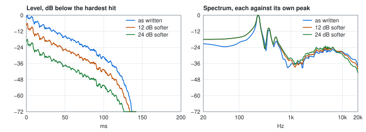

# Design

How Halyard makes a sound, and why each stage is built as it is. The [user guide](guide.md) says how to play it, the
[patch reference](patch.md) lists every field, the [presets](presets.md) show what it makes, and the
[validation record](validation.md) holds the measurements this page cites.

## The signal path

One hit is a sum of sources into one saturator, band-limited once:

$$
x(t)=b(t)+\sum_{j=1}^{J}w_j(t)+\sum_{k}c_k(t)+v(t),\qquad y(t)=S_\alpha\big(x(t)\big),\qquad \mathrm{out}[m]=p\,g_{\mathrm{out}}\sum_{k=0}^{L-1}h[k]\,y\!\left(\tfrac{mK-k}{F}\right)
$$

- b is the body, w_j the noise layers (J ≤ 4), c_k the rims (up to two) and v the brush, if any.
- S_α is the saturator.
- h is the frozen decimator, of length L; F is the internal rate and K the decimation factor.
- g_out is the output gain and p = ±1 the polarity.

Everything before the decimator is a pure function of time, with no state. The trigger is at t = 0, knot times are
milliseconds ≥ 0, and internal sample n lies at t_n = n/F, computed by division and never accumulated.

- **The body** is the drum's head: up to four modes at fixed ratios of the tuning, the ideal membrane's 1, 1.593, 2.136
  and 2.295 to start from, under one pitch glide, the higher modes dying first. A single high mode is a ping: a snap, or
  a click.
- **The noise layers** are one seeded noise seen through different bands. A short wide layer is the stick; a longer one
  is the wires, which `rattle` gates at the body's fundamental.
- **The rims** are what a stick on the hoop adds: modes at their own frequencies, which the tuning and the glide leave
  alone.
- **The brush** is a layer whose band moves while it sounds.
- **The drive** is a saturator on the sum. It adds harmonics and lowers the crest factor, and is the main source of the
  aliasing a render could have, so it is what the report watches most.

Every change of level over time is a curve of knots in the patch, with no hidden envelope. Claps, flams, rolls and
softer hits are written the same way, as ordinary knots, by the editing commands.

## Curves

Every curve is a cubic Hermite curve through its knots, with PCHIP slopes: the weighted harmonic mean at interior knots,
and the shape-preserving three-point rule at the ends (Fritsch and Carlson; Fritsch and Butland). A curve is constant
outside its knots and integrates exactly.

- **Amplitude curves** start and end at 0 with zero end slopes, and peak at exactly 1.
- **The pitch curve** starts at 0 ms, ends at ratio 1 with a zero last slope, and keeps its first slope.

The curves are monotone between knots, so amplitudes stay within [0, 1] and every body frequency is extreme only at
pitch knots: domain checks need only the knots.

**The peak and the shoulder.** The peak of a shape always has zero slope, because its secants change sign, so the first
segment after a peak starts flat and rounds the top of a decay by 1–5 dB against an exponential. A fast decay right
after the peak needs the opposite, so a shoulder knot within about 0.1 ms after the peak keeps the slope there steep;
the presets and `bursts` place one. Inside a tail, knots every 10 dB of decay stay within 0.15 dB of an exponential.

**Every knot is a kink.** The second and third derivatives jump at knots, and a fast segment under a large carrier
aliases. The kink bound accounts for every knot (see [the validated domain](#the-validated-domain)).

## The body

$$
b(t)=g_b\sum_{i=1}^{M}a_i\,e_b\big(\tau_i(t)\big)\,\sin\phi_i(t),\qquad \phi_i(t)=2\pi f_0\,r_i\,R(t),\qquad R(t)=\int_0^t r
$$

$$
\tau_i(t)=\begin{cases}t & t\le t_{\mathrm{pk}}\\ t_{\mathrm{pk}}+s_i\,(t-t_{\mathrm{pk}}) & t>t_{\mathrm{pk}}\end{cases},\qquad s_i=r_i^{\,\beta}
$$

g_b = 10^(level_db/20), f₀ is `tune_hz`, r(t) is the pitch ratio curve, e_b is the body shape, and t_pk is the time of
its first knot at gain 1.

**Modes.** One to four. The first has ratio exactly 1 and defines the tuning; ratios increase strictly and stay ≤ 8
(Fletcher and Rossing; Rossing et al.). Mode levels a_i form a spectral shape whose loudest mode is exactly 0 dB, as an
amplitude shape peaks at exactly 1: levels are gains, mode levels a shape.

**One glide.** All modes follow the same pitch ratio curve, because tension modulation raises every mode of a head
together (Avanzini and Marogna). Phase is integrated exactly, and every mode starts at zero phase, zero displacement at
the strike.

**Damping.** With `damping` β, mode i plays the body shape's decay s_i = r_i^β times faster, from the peak on, while the
rise to the peak stays common to all modes. For an exponential decay this gives a decay rate proportional to r_i^β.
Compressing time, rather than raising the shape to a power, keeps the construction simple:

- it is C¹, since the shape's slope at its peak is zero;
- each mode's envelope is still a shape that peaks at exactly 1;
- its jumps scale by s_i² and s_i³, so the kink bound covers it with the same formula, whereas a power of a shape can
  have a singular third derivative where the shape touches zero;
- the fundamental (s₁ = 1) lasts longest, so the body's span is the last knot of its shape.

Harmonics come from the modes and from the drive; a mode at ratio 2 is a second harmonic. `tune_hz` reaches 4 kHz, so a
snap or a rim click can be a single high ping.

## Rims

A rimshot strikes the hoop with the head; a cross-stick strikes only the hoop, the stick laid across the head. A hoop
and a stick ring with no harmonic relation to the head, so each rim is its own modal source:

$$
c_k(t)=g_k\sum_{i=1}^{M_k}a_{ki}\,e_k\big(\tau_{ki}(t)\big)\,\sin 2\pi f_{ki}t,\qquad s_{ki}=(f_{ki}/f_{k1})^{\beta_k}
$$

with τ_ki as for the body, from the rim shape's peak. Each rim has one to eight modes in Hz, strictly increasing, the
loudest exactly 0 dB. A rim has no glide, ignores `tune_hz` and never gates the rattle. Its shape's knots enter the kink
bound as the body's do, with a constant frequency in place of φ₁′.

## Noise layers

$$
w_j(t)=g_j\,e_j(t)\,\Big(1-d_j\,e_b(t)\,\tfrac{1-\cos\phi_1(t)}{2}\Big)\,n_j(t)
$$

$$
n_j(t)=\gamma_j\sum_{k=1}^{20000}\lvert H_j(f_k)\rvert\,\rho_k\cos(2\pi f_kt+\theta_k),\qquad f_k=k\ \mathrm{Hz},\qquad \gamma_j^2\sum_k\lvert H_j(f_k)\rvert^2=\tfrac12
$$

**One realization, several spectral windows.** Every layer uses the same components: SHAKE-256 (FIPS 202) over the key
`snare/noise/v1` and the seed gives Rayleigh amplitudes ρ_k with mean square 2 and uniform phases θ_k. Each layer
weights them by its own band |H_j|, second-order Butterworth skirts with their half-power points at the band edges. The
layers are therefore coherent:

- identical bands give bit-identical noise;
- a crossfade between two layers is a spectral morph of one noise;
- editing a band reweights the same components instead of rerolling them;
- two identical layers at equal level sum to +6 dB, not +3 dB.

**Layers rather than a filter envelope.** A snare's noise loses its high frequencies as it decays. A time-varying filter
has no exact form in this structure: every sample would need its own 20,000-term sum. Layers keep one exact table each
and express the same motion: a short layer with a high band over a longer one with a lower band.

**Rattle.** Snare wires slap the resonant head, so their noise is gated at the head's fundamental. The rattle factor
follows the first mode's phase φ₁, glide included, and the body shape, because a head that has stopped moving drives no
wires. It stays within [1 − d_j, 1] and is smooth, so it adds no kinks of its own. Rattle reads the body's shape and
phase, not its level, so a silent body can still gate a layer: a buzz at the body's pitch.

**Calibration and span.** Each n_j has the stationary mean square of a unit sine, ½, and realizations are never
renormalized. The noise repeats every second, so noise shapes end by 1000 ms. Exact samples at any rate come from one
inverse real FFT per layer, of length F × 1 s, and tables are cached across renders while a layer's seed and band stay
the same.

**Each seed is a take.** The noise is drawn from the seed, so every seed gives a slightly different sound, and the seeds
seed, seed + 1, … are the round-robin takes of one sound. A short, narrow noise event has few independent components, so
its level is itself random: a burst like the snap preset's varies far more between seeds than a snare's wires. Delivery
therefore keeps one gain per set, offers level matching and reports the spread (see
[levels and sets](#levels-and-sets)). A `[takes]` table also varies how each take is struck and when its later rises
come, drawn from the seed under `snare/takes/v1` ([patch reference](patch.md#takes)).

## The brush

Bristles swept across a head make a noise whose band moves. The brush is a layer with a sweep s(t), a ratio that
multiplies both band edges:

$$
v(t)=g\,e(t)\,q(t)\sum_k B\big(u(t)-k\big)\,n_k(t),\qquad u=3\log_2 s(t)
$$

n_k is the brush's noise in its band moved by k third-octaves, B the cubic B-spline and q the rattle. Because the n_k
are one noise, the sum is that noise weighted by Σ_k B(u − k)|H_k|: a filter, not a crossfade. It keeps the written
band's shape within 0.5 dB down to 30 dB below its peak, and its level within 0.1 dB, at every position of the sweep
(measured on 300 random bands). The sweep's ratios lie within 0.5 … 2 and an octave apart at most, so a brush reads at
most seven tables. The sweep is held before its first knot and after its last, with zero end slopes, so u is C¹ and the
blend C²: the kink bound gains the jumps of u″ and u‴ at the sweep's knots, and of B‴ where u crosses a whole number.

## The drive

$$
S_\alpha(x)=\frac{\tanh\alpha x}{\tanh\alpha}\ \ (\alpha>0),\qquad S_0(x)=x,\qquad \frac{\alpha}{\tanh\alpha}=10^{\,\mathrm{drive}/20}
$$

The drive in dB is the saturator's small-signal gain, and 0 dB is exact bypass. The saturator is odd, S(1) = 1 exactly,
and α is solved by bracketed root finding on [G − 1, G].

On noise, the saturator's aliasing depends on the product α·g_j, so for strong drive the quantity to reason with is
**noise level + drive**, in dB: a layer at −6 dB with 24 dB of drive aliases as a layer at 0 dB with 18 dB does.

## Struck softer

A patch is one hit, at the hardest strength it will be played. A softer hit of the same drum is another patch, which
`halyard softer PATCH DB` writes, so every change is visible and can be edited. With v = 10^(−DB/20), it applies three
rules from the physics of a struck head:

| Rule | Edit | Physics |
| -- | -- | -- |
| Level | Every source level falls by DB, before the drive | The head responds linearly, so every source scales together; entering the drive lower, a softer hit gains fewer harmonics from it |
| Glide | The pitch curve's excess over 1 scales by v² | Tension modulation raises the pitch in proportion to the vibration's energy, the square of its amplitude |
| Contact | Every rise lengthens by v^(−1/5), later knots shifting by the added time; every layer's upper band edge scales by v^(1/5) | Hertz's contact law (Johnson): a slower strike stays longer on the head, so it excites less high frequency |

Nothing else changes. At 12 dB softer, a 1.08 glide becomes 1.005, a 0.05 ms rise becomes 0.066 ms, and a 16 kHz upper
edge becomes 12.1 kHz.

A rise is the run of increasing knots that ends at a local maximum, so each burst of a clap has its own. The rules hold
on the whole curve, not only at its knots: PCHIP slopes scale with the data, so scaling the knots' excess scales the
whole glide, and every rise runs between two zero-slope knots, so lengthening it leaves the rest of the shape unchanged.

The exponents are options, `--glide 2` and `--contact 0.2`, and 0 turns a rule off. The command fails, rather than
clamping, when an edit would leave the valid domain. `flam` and `roll` strike the drum several times by the same rules,
and `stack` sums two hits into one patch.

## Rates and the decimator

**Families.** F = K × base, where base is 44.1 or 48 kHz and K = 32: 1.4112 or 1.536 MHz. The 88.2 and 96 kHz exports
reuse their family's F and filter with factor K/2, and 176.4 and 192 kHz with factor K/4, so a 96 kHz file is exactly
the 48 kHz file with the in-between samples filled in.

**Bandwidth.** 20 kHz at every export rate: passband within 0.001 dB, taps summing to exactly 1, and a stopband of at
least 110 dB from base/2 upward. So a 96 kHz snare pitched down an octave keeps only 10 kHz.

**Decimators.** A Kaiser prototype at 116 dB, converted to minimum phase by the full-length homomorphic method at 2²⁰
points, then renormalized. Minimum phase keeps every transient free of pre-ringing. They ship as data with SHA-256
checksums: 5,183 taps (3.67 ms) for the 44.1 kHz family and 2,891 (1.88 ms) for 48 kHz, passing 0–20 kHz within 4·10⁻⁵
dB and rejecting at least 115 dB ([validation](validation.md#decimators)).

**Timing.**

$$
\mathrm{out}[m]=\sum_{k=0}^{L-1}h[k]\,y[mK-k],\quad y[n]=y(n/F)\ \text{for}\ 0\le n<N,\ \text{else } 0;\qquad N=\lfloor T_{\mathrm{src}}F\rfloor+1,\qquad N_{\mathrm{out}}=\Big\lfloor\tfrac{N+L-2}{K}\Big\rfloor+1
$$

T_src is the latest end among the shapes of the audible sources. A silent body still gates rattle inside the layers it
gates, but never lengthens a file. Nothing trims, fades, high-passes or removes DC. Every file starts at exactly zero,
since every shape starts at 0, and ends in the filter's decayed tail, so a sampler needs no fades.

**Evaluation.** The internal signal is computed in blocks of 2¹⁶ samples aligned to n = 0, each source only over its
support, so a longer render never changes earlier samples. Curves are evaluated per segment slice rather than by
per-sample lookup. Noise tables are computed together for each render and cached. Decimation runs in parallel chunks
that are bit-identical to a single `upfirdn` call.

**Why 32 times.** Each doubling of K buys 6 dB of noise level + drive, as the knee-slew law predicts (q ∝ α·g/F). K is
the smallest factor at which every preset is inside the validated domain with at least 3 dB of drive headroom, for seeds
1–16, within the performance budget. Headroom, not margin, is the criterion, because near the boundary the predicted
error moves 11–12 dB per dB of drive. At 16× the crack preset, a 30 µs stick over wires up to 12 kHz, keeps only 1.7 dB
of drive headroom; at 32× every preset keeps at least 16 dB ([validation](validation.md#the-choice-of-k)).

**Budget.** From 44.1 to 96 kHz, a 0.5 s hit with three noise layers renders in ≤ 300 ms, report included; the longest
sound, 2 s of body with 1 s of noise, in ≤ 1.5 s; a pack of four velocity layers with eight takes in ≤ 15 s; all within
300 MB above the interpreter's baseline ([validation](validation.md#performance)).

## The validated domain

There are three separate promises:

- **The valid domain** is what the parser accepts ([patch reference](patch.md#validation)). The renderer promises
  defined, finite output with bounded time and memory.
- **The validated domain** is where rendering accuracy, an aliasing error at or below −100 dB, is demonstrated. Every
  render reports whether it lies inside.
- **The voiced regions** are the presets' recorded neighbourhoods.

**The rule.** With P the output peak at unity gain:

$$
\text{predicted}=C\,e^{-\pi^2/q_{\mathrm{knee}}}\,P+B_{\mathrm{kink}}\;\le\;10^{-5}\,P\qquad(\text{or }10^{-7}\text{ when }P<10^{-2})
$$

- **q_knee**, the knee slew, is the largest step of αx between internal samples that crosses zero or touches |αx| ≤ 1:
  the step where tanh bends, which is what aliases, rather than the largest step overall.

- **B_kink** is a first-principles bound on the kinks' aliasing:

  $$
  B_{\mathrm{kink}}=\sum_{\text{knots}}\;\sum_{n=2,3}\frac{4\,\zeta(n+1)\,B\,\lvert J_n\rvert}{(2\pi F)^{n+1}},\qquad B=\tfrac{\text{base}}{2}
  $$

  Each J_n is a jump in the n-th derivative of y at a knot, computed exactly from each carrier and its slope at every
  knot and from the saturator's local slope S′ and curvature S″. The bound covers:

  1. **Body modes.** Each mode's knots after the peak are mapped by its decay compression, so their jumps scale by s_i²
     and s_i³; at pitch knots the third derivative jumps, scaled by r_i.
  2. **Rattle.** A layer with rattle also jumps wherever the body shape does, through e_b, and at every pitch knot,
     through φ₁.
  3. **Rims and the brush.** A rim's modes jump at its shape's knots at a constant frequency. A brush jumps at its
     shape's knots, at its sweep's knots through u″ and u‴, and where u crosses a whole number, through B‴.
  4. **Carriers at knots.** Noise values and slopes at knot times come from the exact tables by cubic interpolation,
     within 1.6·10⁻⁶ of the noise's RMS in value and 1.0·10⁻⁴ of its RMS slope; the bound is inflated by 1% to cover it.

- **C = 0.54**, the smallest constant that covers every converged fixture of the adversarial grid with at least 6 dB of
  margin. No fixture measures more than its kink bound ([validation](validation.md#the-rules-constant)).

- The rule is evaluated per render, and therefore per take.

**Drive headroom** is how much the drive can change before the status does; it is negative outside. Drive does not
change the saturator's input x, so one render records what the rule needs at every other drive:

- **the knee slew at every α, exactly:** q(α) = α·M(1/α), where M(m) is the largest step of x that crosses zero or has
  an end within |x| ≤ m; the render keeps M's small upper frontier;
- **the kink bound at every α, exactly,** from the jumps at every knot and S′ and S″ there;
- **a lower bound on the output peak:** the exact output at a few positions, its own loudest outputs, the loudest
  undriven outputs just after the crest of x, and the loudest outputs at full drive just after the steepest zero
  crossing.

The prediction is then exact or overestimated at every drive, so the headroom errs only on the safe side.

**The rule is not monotone in drive.** A step near the knee counts only while α·reach ≤ 1, so just below the α where it
stops counting the domain can have an outside island. The search therefore visits every 0.5 dB of drive and both sides
of every α at which the knee slew drops, then refines the first change of status. Against full renders on every grid
fixture, the reported headroom is never optimistic ([validation](validation.md#drive-headroom)).

`halyard verify` renders a patch or its takes at 128 times the base rate and measures the shipped render against it, so
a setting outside the domain can still be checked on its own.

## Reproducibility

The same patch, renderer version and frozen decimator reproduce the same sound. On one machine and environment the
output is bit-identical; across machines and library versions it agrees within floating-point rounding, so
cross-platform tests use tolerances, not hashes.

Within a schema version, a release never changes the sound of an existing patch beyond rounding, which golden renders of
every preset enforce. A change that would alter old patches becomes a new schema version, and older schemas keep
rendering as they did.

The noise coefficients are a pure function of the seed, through SHAKE-256 and a Box–Muller map of its own, never a
library generator. PCM dither comes from the same construction under its own key, `snare/dither/v1`, so a PCM file is as
reproducible as a float one. In a pack, take j of every velocity layer uses that layer's seed + j − 1.

The tests hold these invariants:

- repeating a hit changes nothing;
- editing the body never changes the noise realization (it does change the rattle);
- editing a band reweights the same noise, and identical bands give bit-identical layers;
- output gain and polarity never touch synthesis;
- a longer render never changes earlier samples;
- the 48 kHz export equals every second sample of the 96 kHz export;
- a take differs from its patch only as its seed and `[takes]` say, and its file records that seed and its gains;
- `softer` by 0 dB changes nothing, and `softer` by a then by b equals `softer` by a + b, up to the decimal rounding of
  the values it writes;
- a pack re-renders bit-identically;
- every exported WAV records the patch text, renderer version, decimator checksum and dependency versions.

## Levels and sets

- Gain mode applies the output gain; peak mode scales to a sample-peak target of at most 0 dBFS, and true-peak mode to a
  true-peak target. Silence stays silence.
- When a gain-mode render exceeds full scale, `render` refuses to write it and `audition` keeps playing the last valid
  buffer; both state the peak and the reduction needed, and `--allow-over` writes a float file anyway. Nothing is ever
  clipped, and the final buffer is checked for non-finite values.
- **A set shares one gain.** The takes of a render, and every file of a pack, are scaled together, and in peak mode that
  gain brings the loudest file to the target. Takes differ more in peak than in loudness, so normalizing each to its own
  peak would make round robins uneven.
- **Level matching**, with `--level-match`, instead scales each take to the loudness of its layer's first take, for
  sounds whose takes vary a lot, such as snaps. The report flags any set whose loudness spread exceeds 1 dB, and each
  file records its take gain.

## Files

Output is mono WAV from Halyard's own RIFF writer:

- **float32** by default;
- **PCM** at 24 or 16 bits, with the plain PCM format tag that hardware samplers read most widely, and triangular (TPDF)
  dither of ±1 LSB from the seeded generator (Lipshitz et al.). Exact zeros are not dithered, so the first sample stays
  zero. A PCM render must peak at least 2 LSB below full scale, so dither never clips it; peak mode lowers its target by
  those 2 LSB.

A file holds `fmt` and `data` chunks, a `fact` chunk for float, a `smpl` chunk with the root note from `tune_hz`
(omitted when the body is silent), and a private `snar` chunk with the patch text and provenance: the seed, the take and
set gains, the renderer version and the decimator checksum. `halyard extract` gives back the exact patch.

## Packs

`halyard pack` renders a multisample. Each patch is one velocity layer, loudest first, and each layer gets N takes. The
patches must share their output settings, and their measured loudness must fall from each layer to the next. Files are
named `<stem>_v<top velocity>_rr<take>.wav`, so they also map by hand, and `<stem>.sfz` maps them:

- velocity ranges follow a square law, 40·log₁₀(v/127) dB, placed from each layer's loudness relative to the loudest;
- one `<group>` per layer carries its range and a curve point at every velocity in it, so the level follows the square
  law across layer boundaries;
- takes cycle in sequence (`seq_length`, `seq_position`);
- the drum never transposes (`pitch_keytrack=0`);
- the key defaults to 38, the General MIDI snare, or 39, the hand clap, when no layer has a body.

Two SFZ players, sfizz and liquidsfz, play packs as mapped ([validation](validation.md#packs-in-two-sfz-players)).

## The report

After each render the report shows the tuning in Hz and as a note ± cents, with the mode frequencies; the source and
exported duration, sample rate, format and seed; the sample peak, the true peak and the loudness, the largest K-weighted
momentary loudness (ITU-R BS.1770, EBU Tech 3341) over every window position; the validated-domain status and margin,
its dominant cause (saturation, or kinks, with the knot that contributes most, named by its path) and the drive
headroom; for sets, the loudness and peak spread of the takes, and each take's length when they differ; and the render
time.

## Audition

Audition plays the exact float buffer that `render` would write; PCM formats add only their quantization. Each edit
starts a render tagged with an increasing generation number, and stale renders are dropped; an invalid edit leaves the
last valid buffer playing; a new buffer takes over at the next hit boundary. The stream opens at the patch's sample rate
and never resamples: on Windows through WASAPI, shared and then exclusive, rather than the default host API, which would
convert; on macOS with Core Audio told to switch the device's rate or fail. A dropout, a block the device ran out of
samples for, is counted on the audio thread and reported from the play loop.

- `--bpm` places hits on beats 2 and 4 of each 4/4 bar, and `--beats` chooses others.
- `--with FILE` loops a bed under the hits. It must be within 1 ms of a whole number of bars, and restarts on the tempo
  grid rather than at its own length, so it never drifts from the hits.
- `--against FILE` alternates the render with a sample, hit by hit, matched in loudness and rematched on every
  re-render; the sample is scaled, never the render. With `--blind`, each pair plays in random order, revealed when
  audition stops.
- Audition warns when the matched sample, or the hits over the bed, would clip the device.
- Several patches cycle hit by hit, and `--takes N` cycles takes.

## What it leaves out

Halyard models the sound of a hit, not a drum: it does not simulate wire physics, a shell, a stick's position or a room.
Its rimshots, cross-sticks and brushes are synthesized, like the rest. Reverb and processing chains such as gated reverb
belong in the DAW, and so does stereo width: two takes panned apart widen a snare's noise while its body stays centred.
It renders offline; it is not a plugin.

## Code map

The central call is `render(patch) → (audio, report)`.

| Module | Responsibility |
| -- | -- |
| `patch.py` | Schema, parsing, validation, canonical TOML; the editing operations `tune`, `stretch`, `bursts`, `softer`, `flam`, `roll`, `stack` and the takes' strikes |
| `tuning.py` | MIDI note numbers and names, and the frequencies a note name or a number gives |
| `curve.py` | Hermite curves, PCHIP slopes, exact integrals, knot jumps, decay compression |
| `noise.py` | Seeded noise, coherent layer tables (cached), values and slopes between samples, seeded dither |
| `voice.py` | The body, noise layers with rattle, rims, the brush's blend, the drive; the knee slew at every drive, the kink bound |
| `render.py` | Rates, frozen decimators, parallel decimation, the domain rule and drive headroom, takes, the report, export |
| `loudness.py` | BS.1770 K-weighting at every rate, momentary loudness |
| `pack.py` | Velocity layers, takes, one gain per pack, the SFZ mapping |
| `reference.py` | The reference renderer and the comparison behind `halyard verify` |
| `wav.py` | RIFF writing and reading, float and PCM |
| `audition.py` | Hits on the beat grid, patches and takes cycling, beds, A/B and blind order, watching, playback |
| `cli.py` | The commands |
| `data/` | Frozen decimators and their checksums, the eighteen presets |

## References

- F. N. Fritsch and R. E. Carlson (1980). Monotone piecewise cubic interpolation. *SIAM Journal on Numerical Analysis*.
- F. N. Fritsch and J. Butland (1984). A method for constructing local monotone piecewise cubic interpolants. *SIAM
  Journal on Scientific and Statistical Computing*.
- N. H. Fletcher and T. D. Rossing (1998). *The Physics of Musical Instruments*, 2nd edition. Springer. Membrane modes
  and the snare drum.
- T. D. Rossing, I. Bork, H. Zhao and D. O. Fystrom (1992). Acoustics of snare drums. *Journal of the Acoustical Society
  of America* 92(1).
- T. D. Rossing (2000). *Science of Percussion Instruments*. World Scientific.
- S. Bilbao (2012). Time domain simulation and sound synthesis for the snare drum. *Journal of the Acoustical Society of
  America* 131(1).
- F. Avanzini and R. Marogna (2010). A modular physically based approach to the sound synthesis of membrane percussion
  instruments. *IEEE Transactions on Audio, Speech, and Language Processing* 18(4). Tension modulation and pitch glide.
- K. L. Johnson (1985). *Contact Mechanics*. Cambridge University Press. Hertzian impact.
- B. H. Repp (1987). The sound of two hands clapping: an exploratory study. *Journal of the Acoustical Society of
  America* 81(4).
- L. Peltola, C. Erkut, P. R. Cook and V. Välimäki (2007). Synthesis of hand clapping sounds. *IEEE Transactions on
  Audio, Speech, and Language Processing* 15(3).
- S. P. Lipshitz, R. A. Wannamaker and J. Vanderkooy (1992). Quantization and dither: a theoretical survey. *Journal of
  the Audio Engineering Society* 40(5).
- NIST FIPS 202 (2015). SHA-3 Standard: Permutation-Based Hash and Extendable-Output Functions (defines SHAKE-256).
- ITU-R BS.1770. Algorithms to measure audio programme loudness and true-peak audio level.
- EBU Tech 3341. Loudness metering: "EBU mode" metering to supplement loudness normalisation.
- The SFZ format specification, sfzformat.com.
