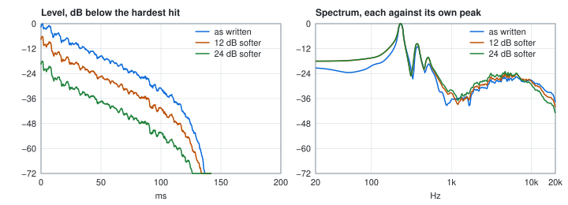
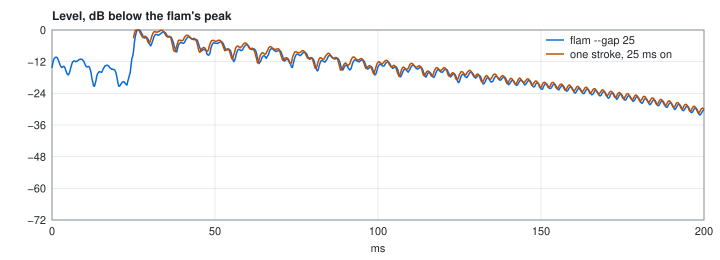

# User guide

This guide is for producers and sound designers who program snares and claps. It covers the workflow, recipes for common
edits, and how to read what a render reports. Every field is in the [patch reference](patch.md), and how the instrument
works, and the evidence for it, in [the design](design.md) and [the validation record](validation.md).

## The workflow

1. **Start from the nearest preset.** `halyard init crack --tune D3 > snare.toml`. The presets are `tone`, `crack`,
   `fat`, `driven`, `clap` and `snap` (below). `--tune` takes a note name or a frequency; the patch stays in Hz.
2. **Audition it over the track.** `halyard audition snare.toml --watch --bpm 92 --with loop.wav` plays the snare on
   beats 2 and 4 over your loop and re-renders every time you save the file. Edits take over at the next hit.
3. **Match it against the sample it should replace.**
   `halyard audition snare.toml --watch --against reference.wav --blind` alternates your render with the sample, matched
   in loudness, in a random order that audition reveals when you stop it.
4. **Derive softer layers.** `halyard softer snare.toml 8 > snare-8.toml`, and so on.
5. **Pack them with takes for the sampler.**
   `halyard pack snare.toml snare-8.toml snare-16.toml snare-24.toml --takes 6 --out kit/`.

Every file is exact and reproducible: `halyard extract` gives back the exact patch of any exported file, take included.
It never prints text holding control characters, which no patch does and a terminal would act on.

## The presets

| Preset | What it is | Try |
| -- | -- | -- |
| `tone` | Two modes, at 196 Hz and 1.59 times it, a 1.06 glide, a short click to 12 kHz, and wires to 200 ms | tuning, damping, the second mode's level |
| `crack` | A 1.15 glide, three modes, a 0.03 ms click to 18 kHz, and wires to 140 ms | the stick's level and rise, `stretch` |
| `fat` | Three modes at 165 Hz, wires to 160 ms with rattle 0.6, and a layer below 5.5 kHz to 420 ms | rattle, the low layer's band and length |
| `driven` | 12 dB of drive over three modes and wires to 200 ms | drive, the wires' level |
| `clap` | A train of four bursts at 0.9–3.2 kHz and a 0.7–6 kHz tail to 220 ms, with no body | `bursts`, the bands, the tail layer |
| `snap` | One mode at 1.8 kHz and a 20 ms burst at 2–14 kHz, undriven | the mode's tuning, the burst's band |
| `machine` | Two modes, 1 and 1.83 times 180 Hz, and noise at 1.8–14 kHz to 190 ms; no wires, a 1.02 glide | the second mode's ratio and level, the noise's length |
| `house` | Two modes with a 1.12 glide, noise at 2.5–15 kHz to 260 ms that outlasts them, and 6 dB of drive | drive, the glide, the noise's length |
| `short-clap` | A train of bursts at 0.9–5 kHz to 74 ms and a tail to 90 ms, undriven | `bursts`, the tail layer |
| `rim-click` | A rim's two modes, 455 Hz and 1.67 kHz, and a 3 ms tick; no head | the rim's two frequencies, `stretch` |
| `big-clap` | Two trains, at 0.8–2.6 kHz and 1.5–6 kHz, the second starting later, over a tail to 420 ms | the trains' `--start` and bands, the tail |
| `long-snare` | Wires to 620 ms and a layer below 4.5 kHz to 540 ms | the wires' length and rattle, drive |
| `rimshot` | `crack`'s head with a rim of four modes from 1.24 to 7.62 kHz | the rim's level and damping |
| `cross-stick` | A rim of four modes from 520 Hz to 4.1 kHz over a head 12 dB down | the rim's damping and frequencies, the body's level |
| `brush` | A 300 ms brush sweep over a head 18 dB down, and wires gated by it | the sweep's knots, `stretch brush[1].sweep` |
| `zap` | One mode falling three octaves to its tuning in 40 ms | the glide's first ratio, `stretch body.pitch` |
| `reverse` | Noise and a brush rising for 390 ms, the brush's band rising with it, cut at the end | `stretch all` to fit the bars, the sweep's start |
| `closing` | Two modes and a brush whose band falls an octave in 150 ms | how far the sweep falls, `stretch brush[1].sweep` |

They are matched in loudness (−27 LUFS) so you can compare them fairly, and they peak below −1 dBFS. Raise `output.db`
as you need. Hear each one, with its figure, its report and its patch, in [the gallery](presets.md).

## Every control

Every field, its range and what it does are in the [patch reference](patch.md). Paths count from 1: `noise[2].amp[3]` is
the third knot of the second layer.

## Editing commands

Each prints a complete patch; redirect it to a file. They rewrite points and never add parameters, so you can always
keep editing the result by hand. They fail, and say why, rather than clamp.

- **`halyard tune PATCH NOTE`** sets `tune_hz` from D3, F#3, Eb4 or a frequency in Hz. Modes, glide and rattle follow,
  being ratios.

- **`halyard stretch PATCH CURVE... FACTOR [--after MS]`** rescales knot times after each shape's peak (0 ms for pitch),
  or after `--after`. `all` names every amplitude shape, so `halyard stretch snare.toml all 0.8` shortens a whole sound;
  `--after 0` also scales the rises, which tightens a clap.

- **`halyard bursts PATCH LAYER --count N --spacing MS …`** rewrites a layer's shape as a clap train: N bursts (1–10),
  each rising in `--rise` ms (default 0.1) to its peak, a shoulder 0.1 ms after, and down to `--dip` (default 0.1, over
  the lower of the two peaks) before the next. Each gap is `--growth` times the previous; peaks follow `--taper` with
  the loudest exactly 1; the last burst decays over `--tail` ms (default 80) with a knot 20 dB down a third of the way.
  `--start MS` delays the first burst, so two layers with different bands and starts make a stacked clap.

- **`halyard softer PATCH DB [--glide P] [--contact P]`** gives the same drum struck DB softer, by three rules from the
  physics of a struck head:

  - every source level falls by DB, before the drive, so the drive adds fewer harmonics;
  - the glide's excess over 1 scales by v^glide (default 2: tension modulation follows the vibration's energy), with v =
    10^(−DB/20);
  - every rise lengthens by v^(−contact) and every layer's upper band edge scales by v^contact (default 0.2: Hertz's
    contact law: a slower strike excites less high-frequency energy).

  At 12 dB softer, a 1.08 glide becomes 1.005, a 0.05 ms rise 0.066 ms and a 16 kHz edge 12.1 kHz. An exponent of 0
  turns its rule off. `softer` by a then b equals `softer` by a + b up to the decimals it writes.

  

- **`halyard flam PATCH --gap MS [--grace DB] [--glide P] [--contact P]`** strikes the drum twice: a grace note
  `--grace` dB softer (default 12), by `softer`'s rules, then the main stroke `--gap` ms later. Every shape is the
  grace's until the main stroke starts, takes the grace's value there, and goes on as the main stroke's; the glide
  restarts at the main body's peak. The two strokes share their bands and a brush's sweep, and the grace's higher modes
  decay with its fundamental. It fails rather than drop knots when a shape would need more than 32 or run past its
  limit.

  

- **`halyard stack PATCH OTHER [--db DB]`** writes one patch that sounds both, such as a snare with a clap layered over
  it, through one drive: the layers, rims and brushes of both, within a patch's limits, OTHER's `--db` louder. The body
  is the one that sounds, and two sounding bodies are refused, since a patch is one drum's head; the drive, the output
  and the seed are PATCH's, so OTHER's noise is redrawn for PATCH's seed. Without drive, a stack renders exactly as the
  two hits added.

- **`halyard roll PATCH --count N --spacing MS [--growth G] [--crescendo DB]`** strikes the drum N times, as `flam`
  strikes it twice: each gap is `--growth` times the one before (below 1, the roll speeds up), and the first stroke is
  `--crescendo` dB softer than the last, the strokes between in even steps, each by `softer`'s rules. Every shape takes
  a stroke's knots in turn, so a stroke costs a shape as many knots as it has before the next stroke: a snare's
  five-knot stick allows about six strokes, a clap's train two, and the noise's second ends a long roll. It fails,
  naming the shape, rather than drop knots, and rather than start a stroke before the one before it strikes.

## Recipes

These start from a preset and take at most three field edits or one command; the test suite checks that each moves the
sound the right way.

| To | Edit |
| -- | -- |
| Change the tuning | `halyard tune snare.toml F3`, or edit `body.tune_hz` |
| Shorten the tail | `halyard stretch snare.toml all 0.7` |
| Raise the stick | raise the stick layer's `level_db` (the short, wide layer) by 4–6 dB, or shorten its rise |
| Raise the body | raise `body.level_db` |
| Raise the wires | raise the wires layer's `level_db` and its `rattle` |
| Lower the bands | lower each layer's upper band edge (`band_hz[2]`) |
| Add drive | raise `drive.db` by 6 and lower `output.db` to keep the peak. In a driven sound the stick is saturated too, so raising it adds less than in an undriven one. |
| Make a ghost note | `halyard softer snare.toml 18` |
| Play a flam | `halyard flam snare.toml --gap 25` |
| Shorten a clap's bursts | `halyard stretch clap.toml all 0.7 --after 0`, or re-run `bursts` with a shorter `--spacing` |
| Lower a clap's bands | lower both edges of each layer's band |
| Shorten a snap, or raise its band | `halyard stretch snap.toml all 0.6`; raise the burst's band and level |
| Move a snap's mode | edit `body.tune_hz` |

**A rattle without a body.** Rattle reads the body's shape and phase, not its level, so a silent body can still gate a
layer: a buzz at a pitch with no tone of its own.

## Reading the report

```
tuning   185.000 Hz, F#3 +0.0 cents; modes 185.0, 294.7, 395.2 Hz
length   260.0 ms source, 261.9 ms exported (12571 samples at 48000 Hz, float32), seed 1
peak     -4.05 dBFS sample, -3.72 dBTP true
loudness -19.0 LUFS, the largest 400 ms momentary loudness (BS.1770)
domain   inside the validated domain: predicted aliasing -137 dB, margin 37.0 dB
         mostly kinks, 64% at noise[1].amp[2] (0.05 ms); drive headroom +21.5 dB
render   86 ms
```

- **tuning** is `tune_hz` as a note and cents, and each mode's settled frequency.

- **length** is the source length (the latest end among the audible sources' shapes: silent sources never lengthen a
  file) and the exported length, which includes the decimator's decaying tail. Every file starts at exactly zero and
  ends in that tail, so a sampler needs no fades. Takes that differ in length, as `[takes]` can make them, show the
  range here and each take's own length on its line.

- **peak** is the sample peak and the true peak: the crest of the output's band-limited reconstruction, measured
  exactly, as `output.mode = "true-peak"` targets it.

- **loudness** is the largest K-weighted 400 ms momentary loudness over every window position (ITU-R BS.1770), in LUFS.
  Short sounds read low, because the window spreads their energy over 400 ms.

- **domain** is the renderer's own prediction of its aliasing error, relative to the peak. Inside means at most −100 dB:
  the grid has demonstrated that every render inside measures below −100 dB ([validation](validation.md)). Outside, the
  render is still defined and exact, but unvalidated; `halyard verify` measures its actual error against a reference
  render.

- **The line under it** says what dominates the prediction:

  - *mostly kinks, 64% at noise[1].amp[2] (0.05 ms)*: a fast segment around that knot under a loud carrier. Lengthen the
    rise around it, or lower that layer.
  - *mostly saturation*: the drive on a loud source with high band edges. Lower the drive, the level, or the layer's
    upper band edge.

  The **drive headroom** is how much more drive the take stands before its status changes. Outside, it is negative and
  the line says what to lower `drive.db` to. It is exact or cautious, never optimistic. Margin and headroom differ: near
  the edge the prediction moves 11–12 dB per dB of drive, so a large margin can mean little headroom.

- **takes** (with `--takes`): the set gain, the loudness and peak spread, and each take's own levels and domain status.
  Each take is judged on its own render.

## Audition

`halyard audition PATCH... [--watch] [--bpm BPM] [--beats 2,4] [--with BED] [--against SAMPLE] [--blind] [--takes N]`

- It plays exactly the buffer `render` writes; PCM formats add only their quantization. It opens the device at the
  patch's sample rate or says it cannot. On Windows it plays through WASAPI, in exclusive mode when the shared mixer
  runs at another rate. On macOS it asks Core Audio to switch the device to the patch's rate, or fails. On Linux, a
  sound server such as PipeWire or PulseAudio may still resample to its own rate; set it to the patch's rate to hear the
  exact samples.
- If the device ever runs out of samples, for example while a long render keeps the computer busy, it says so, with a
  count.
- `--watch` re-renders on every save. Each edit is a numbered generation; stale renders are dropped, an invalid edit
  keeps the last valid buffer playing, and a new buffer takes over at the next hit.
- Without a tempo, hits repeat every rendered length plus 0.5 s. With `--bpm`, they land on beats 2 and 4 of each 4/4
  bar, tails overlapping; `--beats 1,2,3,4` hits every beat (a clap), `--beats 3` is half time.
- `--with BED` loops a bed under the hits. It must be at the patch's rate and within 1 ms of a whole number of bars; it
  restarts on the tempo grid, so it never drifts. A stereo bed opens a stereo stream with the snare centred.
- `--against SAMPLE` alternates the render with a sample, hit by hit, the sample matched to the render's loudness and
  rematched on every re-render. With `--blind` each pair plays in random order, revealed when you stop.
- Several patches cycle hit by hit (velocity layers, or A/B), and `--takes N` cycles takes. The first plays as soon as
  it is ready; the others render behind it.
- It warns when the matched sample, or the hits over the bed, would clip the device.

## Packs

`halyard pack PATCH... --out DIR [--takes N] [--key K] [--level-match]` renders a multisample: each patch is one
velocity layer, loudest first, and each gets N takes (take j of a layer plays its seed + j − 1).

- The layers must share their output settings, and their loudness must fall from each layer to the next.
- Every file of the pack shares one gain, so the layers keep their levels against each other.
- Files are named `<stem>_v<top velocity>_rr<take>.wav`, so they also map by hand in samplers without SFZ. A patch whose
  file name a sampler would read as part of the map, one holding `<`, `>`, `=`, `$`, a backslash, a comment's start, a
  control character or a line break, or beginning or ending with a space, is refused: rename it.
- `<stem>.sfz` maps them. Velocity follows a square law, 40·log₁₀(v/127) dB: a layer's velocities run up to its own,
  where the law reaches its loudness relative to the loudest, and its group carries a curve point at every velocity
  below it, so the level follows the law across layer boundaries and no velocity plays a take louder than it was
  rendered. Takes cycle in sequence; the drum never transposes, and it plays out as a one-shot whatever the note's
  length, so a short note never cuts it. The key defaults to 38, the General MIDI snare, or 39, the hand clap, when no
  layer has a body.
- The pack report lists each layer's loudness, velocity range, take spread and domain status.
- Every file must pass two gates: its true peak at or below 0 dBTP, with no sample over the format's ceiling, and its
  first and last samples below −90 dBFS, so no sampler clicks where the file starts or stops. If one fails, nothing is
  written, every failure is listed, and the report says how far to lower `output.db` in every layer when the level is
  what fails.

## In a DAW

**One-shots.** Drop a rendered WAV on a drum sampler's pad or a sampler's key, set to one-shot, with no loop and no
fades. Every file starts at exactly zero at the strike and ends in its own decaying tail, so the sampler needs neither a
start offset nor a fade. The `smpl` chunk names the root key, the body's tuning as a note, so a sampler that reads it
plays the drum at its pitch on that key; a sound without a body has none. `halyard render --takes N` writes takes `_rr1`
… `_rrN` that share one gain: load them as round robins or random alternatives, so repeated hits are never the same file
twice in a row.

**Formats.** DAWs read `float32`; `pcm24` and `pcm16`, with seeded dither, are for hardware samplers and older software.
A render over full scale is refused in any format, with the reduction it needs, and nothing is ever clipped: lower
`output.db`, use a `peak` or `true-peak` target, or pass `--allow-over` for a float file that keeps the overs.

**Kits.** `halyard pack` writes an SFZ file that any SFZ player loads, with its WAVs beside it: the velocity layers, the
round robins and the square law are in the mapping. sfizz and liquidsfz, two SFZ players built from source, play a pack
as mapped ([validation](validation.md)). A sampler that does not read SFZ maps the files by their names,
`<stem>_v<top velocity>_rr<take>.wav`: the velocity range of each layer is in the pack report.

**Levels.** The presets sit at −27 LUFS so they compare fairly; raise `output.db` or set `output.mode = "peak"` with a
target for a working level, and keep one gain per kit, as `pack` does, so its layers keep their levels against each
other.

**With Ballast and Brightwork.** The presets sit at −27 LUFS so they compare fairly with each other, which leaves them
some 18 dB under Ballast's kicks, which peak at −1 dBTP. For a working balance, set the kick's `output.db` to −10 and
raise each preset's `output.db` by the amount below: in eight bars of 4/4 with the kick on every beat, the snare or clap
on two and four then reads 5 dB under the kick by loudness, Brightwork's hats, raised as its guide says, 10 dB under,
and no file peaks above −1 dBFS. Each was measured against the Ballast preset in the table, at 124 bpm for `house`, 126
for `tech-house` and 138 for `trance`, by `tools/balance.py`, which a test holds to this table.

| Preset | Against Ballast's | Raise `output.db` by | Note |
| -- | -- | -- | -- |
| `tone` | `house` | +4.8 dB |  |
| `crack` | `house` | +4.7 dB |  |
| `fat` | `house` | +4.8 dB |  |
| `driven` | `house` | +4.8 dB |  |
| `clap` | `house` | +4.8 dB |  |
| `snap` | `house` | +1.0 dB | 3.7 dB short, held at −1 dBFS by its peak |
| `machine` | `house` | +4.6 dB | 0.1 dB short, held at −1 dBFS by its peak |
| `house` | `house` | +4.8 dB |  |
| `short-clap` | `tech-house` | +3.8 dB |  |
| `rim-click` | `tech-house` | +3.8 dB |  |
| `big-clap` | `trance` | +3.4 dB |  |
| `long-snare` | `trance` | +3.5 dB |  |
| `rimshot` | `house` | +4.8 dB |  |
| `cross-stick` | `house` | +4.8 dB |  |
| `brush` | `house` | +4.8 dB |  |
| `zap` | `trance` | +3.5 dB |  |
| `reverse` | `trance` | +3.4 dB |  |
| `closing` | `house` | +4.8 dB |  |

## Exit status

| Status | Meaning |
| -- | -- |
| 0 | done |
| 1 | refused or failed: a render over the format's ceiling, a pack that fails its gates, or an audition that cannot play |
| 2 | bad input: an invalid patch, a file that cannot be read or written, or bad arguments |
| 130 | interrupted with Ctrl+C |

## From Python

Everything the commands do is a function of the package, `halyard_synth`. Patches are frozen dataclasses that check
themselves when made, so an edit that leaves the valid domain raises `PatchError` with every problem's path, as the
parser does. These examples run as a test, in order.

```python
from pathlib import Path

from halyard_synth import patch, render
from halyard_synth.cli import preset_text

p = patch.loads(preset_text("rimshot"))  # or patch.load("snare.toml")
audio, report = render.render(p)  # float32 at the patch's rate, and the report halyard render prints
assert report.inside
print(report)
```

The editing commands are functions from patch to patch, and `dumps` writes the canonical text they print:

```python
ghost = patch.softer(p, 18)  # the same drum struck 18 dB softer
flammed = patch.flam(p, 25.0)  # a grace note 12 dB softer, 25 ms ahead
lower = patch.tune(p, "D3")
clap = patch.bursts(patch.loads(preset_text("clap")), "noise[1]", patch.Train(4, 11.0))
Path("ghost.toml").write_text(patch.dumps(ghost), encoding="utf-8")
assert patch.load("ghost.toml") == ghost
```

Takes, each written with its patch and provenance as `halyard render` writes them, and checked against the reference
render as `halyard verify` does:

```python
from halyard_synth import reference

audio, report = render.render_takes(p, 4)  # seeds 1-4, one gain for the set
for a, take in zip(audio, report.takes, strict=True):
    render.export(f"rimshot_rr{take.number}.wav", a, p, report, take)
assert reference.verify(p, takes=2).passed
```

A pack, as `halyard pack` writes it, from patch files. It renders in worker processes, which start by importing your
script, so a script that packs needs Python's usual guard, or every worker would pack again:

```python
from pathlib import Path

from halyard_synth import pack, patch
from halyard_synth.cli import preset_text


def main() -> None:
    p = patch.loads(preset_text("rimshot"))
    names = []
    for db in (0, 12, 24):
        names.append(f"rimshot-{db}.toml")
        Path(names[-1]).write_text(patch.dumps(patch.softer(p, db)), encoding="utf-8")
    assert pack.pack(names, "kit", pack.Options(takes=2)) == 0


if __name__ == "__main__":
    main()
```

## Outside the family

Acoustic snares, whose sound depends on wire physics, shell, stick position and room; processing chains such as gated
reverb; and stereo width are outside the model. The rimshot, the cross-stick and the brush are synthesized, not models
of a drum. Two takes panned apart widen a snare's noise while its body, identical in every take, stays centred.
