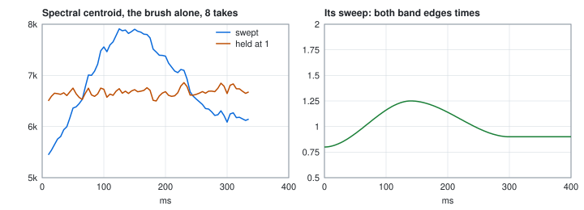

# Patch reference

A patch is a complete TOML description of one hit. Every field is required and the renderer holds no defaults, so a
future default can never change an old patch. The parser refuses anything outside the valid domain and never clamps or
repairs. `halyard init PRESET` writes a complete one to start from; the [user guide](guide.md) shows how to work with it
and [the design](design.md) how each part is computed.

## A patch

```toml
instrument = "snare"
schema = 1
seed = 1

[body]
tune_hz  = 185.0
level_db = -4.0
damping  = 1.0              # mode i decays ratio^damping times faster
modes = [                   # loudest mode exactly 0 dB
  { ratio = 1.0,   level_db = 0.0 },
  { ratio = 1.593, level_db = -5.0 },
  { ratio = 2.136, level_db = -11.0 },
]
pitch = [                   # ratio to tune_hz; starts at 0 ms, ends at 1
  { ms = 0.0,  ratio = 1.08 },
  { ms = 15.0, ratio = 1.0 },
]
amp = [                     # shape: 0 at both ends, highest point exactly 1
  { ms = 0.0,   gain = 0.0 },
  { ms = 0.4,   gain = 1.0 },
  { ms = 25.0,  gain = 0.45 },
  { ms = 90.0,  gain = 0.1 },
  { ms = 180.0, gain = 0.0 },
]

[[noise]]                   # noise[1]
level_db = -10.0
band_hz  = [1500.0, 16000.0]
rattle   = 0.0              # 0 … 1, gated at the body's fundamental
amp = [
  { ms = 0.0,  gain = 0.0 },
  { ms = 0.05, gain = 1.0 },
  { ms = 0.15, gain = 0.7 },
  { ms = 3.0,  gain = 0.1 },
  { ms = 8.0,  gain = 0.0 },
]

[[noise]]                   # noise[2]
level_db = -6.0
band_hz  = [2500.0, 9000.0]
rattle   = 0.5              # 0 … 1, gated at the body's fundamental
amp = [
  { ms = 0.0,   gain = 0.0 },
  { ms = 1.5,   gain = 1.0 },
  { ms = 40.0,  gain = 0.4 },
  { ms = 140.0, gain = 0.08 },
  { ms = 260.0, gain = 0.0 },
]

[drive]
db = 6.0                    # small-signal gain; 0 = bypass

[output]
sample_rate = 48000
format      = "float32"     # "float32" | "pcm24" | "pcm16"
mode        = "gain"        # "gain" | "peak" | "true-peak"
db          = -6.0          # gain in dB, or peak target in dBFS
polarity    = 1
```

## Every field

Paths are the ones the parser and the report use. They count from 1: `noise[2].amp[3]` is the third knot of the second
layer.

### Times and curves

Knot times are milliseconds from the hit. Knots must be at least 10 µs apart. Every curve is a smooth monotone cubic
through its knots (PCHIP): it never overshoots between knots, so an amplitude shape stays within 0 … 1 and the pitch is
extreme only at its knots.

- **Amplitude shapes** (`body.amp`, `noise[N].amp`) start and end at gain 0, and their highest point is exactly 1.
  Levels are set separately, in dB.
- **Knots every 10 dB** of a decay reproduce an exponential tail within 0.15 dB. The first segment after a peak starts
  flat, because the peak has zero slope, and that rounds the top of a decay by 1–5 dB. For a fast decay right after the
  peak, put a **shoulder knot** within about 0.1 ms after the peak, as the presets and `bursts` do.
- **Every knot is a kink.** Very fast segments under loud noise alias. The report tells you when a knot matters and
  which one.

### Body

| Field | Range | What it does |
| -- | -- | -- |
| `tune_hz` | 40 – 4,000 | The settled frequency of the first mode. Up to 4 kHz, so a snap or rim click can be a single high ping. |
| `level_db` | −inf, −90 – +24 | The body's level. `-inf` silences it: the body then still gates rattle, but never lengthens the file. |
| `damping` | 0 – 3 | Mode i decays ratio_i^damping times faster than the fundamental, from the body's peak on. 0: all modes decay together. |
| `modes` | 1 – 4 | `{ ratio, level_db }`. The first ratio is exactly 1; ratios increase strictly and stay ≤ 8. The loudest mode is exactly 0 dB: mode levels are a spectral shape, the body's level is its gain. The ideal membrane gives 1, 1.593, 2.136 and 2.295. |
| `pitch` | 2 – 32 knots | A ratio to `tune_hz`, starting at 0 ms and ending at 1. Every mode follows it: tension modulation raises every mode of a head together. |
| `amp` | 3 – 32 knots | The body shape. Its first knot at gain 1 is the peak, where damping starts. |

Every body frequency, f₀ · ratio · glide, must stay within 10 Hz – 20 kHz at every pitch knot. `halyard tune` refuses a
tuning that would take a mode out of that range; it never clamps.

### Noise layers

One to four `[[noise]]` tables. Every layer uses the same noise, weighted by its own band, so layers are coherent:
identical bands give identical noise, two identical layers at equal level sum to +6 dB, and a crossfade between two
layers is a spectral morph of one noise.

| Field | Range | What it does |
| -- | -- | -- |
| `level_db` | −inf, −90 – +24 | The layer's level. |
| `band_hz` | 20 ≤ low < high ≤ 20,000 | Second-order skirts, half power at the edges. Editing the band reweights the same noise. |
| `rattle` | 0 – 1 | Gates the layer at the body's fundamental, following its glide, while the body shape sounds: snare wires. 0 is off, 1 is full depth. |
| `amp` | 3 – 32 knots | The layer's shape; it ends by 1 s, because the noise repeats every second. |

A typical snare has a short, wide **stick** layer (the click) and a longer **wires** layer, and perhaps a longer layer
with a lower band, so the tail loses its high frequencies. Layers are how the noise's spectrum changes over time: a
short layer with a high band over a longer one with a lower band.

### Rims

Up to two `[[rim]]` tables, or none: the rim struck with the head, as in a rimshot, or instead of it, as in a
cross-stick. A rim rings at its own frequencies, in Hz, for a hoop and a stick have no harmonic relation to the head: it
ignores `tune_hz` and the glide, and never rattles the wires.

| Field | Range | What it does |
| -- | -- | -- |
| `level_db` | −inf, −90 – +24 | The rim's level. |
| `damping` | 0 – 3 | Mode i decays (hz_i / hz_1)^damping times faster than the first, from the rim's peak on; at most 512 times, as fast as a body mode can, or the patch is refused. |
| `modes` | 1 – 8 | `{ hz, level_db }`, from 100 Hz to 20 kHz, strictly increasing, the loudest exactly 0 dB. |
| `amp` | 3 – 32 knots | The rim's shape, within 2 s. |

A **rimshot** is a body and its wires with a loud, short rim on top, a few modes between 1 and 10 kHz; a **cross-stick**
is the rim alone, or with a quiet body and no wires, its modes lower and its shape a few milliseconds long.
`halyard softer` lowers a rim's level and lengthens its rises like the others'; `halyard stretch` names its shape
`rim[1].amp`.

### Brush

One `[[brush]]` table, or none: a noise layer whose band moves during the hit, as wire bristles sweep across a head. It
has a layer's fields, and a sweep:

| Field | Range | What it does |
| -- | -- | -- |
| `level_db` | −inf, −90 – +24 | The brush's level. |
| `band_hz` | 20 ≤ low < high ≤ 20,000 | The band at sweep ratio 1. |
| `rattle` | 0 – 1 | As a layer's: the wires answer a brush too. |
| `sweep` | 2 – 32 knots | `{ ms, ratio }`, within 1 s: both band edges times the ratio, 0.5 – 2, an octave between the lowest and the highest at most. Held before its first knot and after its last, which it leaves and reaches smoothly. |
| `amp` | 3 – 32 knots | The brush's shape, within 1 s. |

The band stays within 20 Hz – 20 kHz at every ratio, or the patch is refused. The moving band is one noise filtered, not
a crossfade of noises: it keeps the written band's shape to within 0.5 dB and its level to within 0.1 dB all along the
sweep. A **sweep** is a long, slow brush rising and falling through a few semitones; a **swish** is a shorter one with a
quicker sweep; a brush **tap** is a short layer, needing no sweep. `halyard stretch` names the sweep `brush[1].sweep`
and stretches it from 0 ms; `halyard softer` treats the brush as a layer and leaves its sweep alone.



### Takes

One `[takes]` table, written last, or none. Without it, the takes of a set, `--takes N` and a pack's round robins, are
the same drum struck the same way, differing only in their noise. With it, each take varies in strength and timing:

| Field | Range | What it does |
| -- | -- | -- |
| `strength_db` | 0 – 6 | Each take is struck up to this much harder or softer, by `softer`'s rules: its level, glide, rises and top move together. |
| `timing_ms` | 0 – 5 | Each later event of the hit, such as a clap's later burst or a roll's next stroke, moves up to this much earlier or later, with everything after it. |

An event is a rise after the first of any shape, with every rise of the other shapes within 1 ms of it, and time itself
moves there: the body, its glide, the layers, rims and brush and its sweep together, so a stroke stays one stroke. The
hit's first rise stays on the beat, and no move brings two knots within 10 µs or a curve past its limit. Every take is
drawn from the seed alone, under its own key, so it is the same take in every version and on every platform, and a
take's WAV carries the patch that renders it again, `[takes]` included. A patch whose hardest or softest take would
leave the valid domain is refused. For a roll of 16th notes, 1–2 dB and 1–2 ms are typical. A pack places a layer by its
takes' loudness together, and `--level-match` is refused for takes that differ in strength, since it would undo them.

### Drive

`drive.db`, 0 – 48 dB, is the small-signal gain of a tanh saturator on the sum of everything. 0 dB is exact bypass. On
noise, what matters is **noise level + drive**: a layer at −6 dB with 24 dB of drive saturates like one at 0 dB with 18
dB.

### Output

| Field | Values | What it does |
| -- | -- | -- |
| `sample_rate` | 44100, 48000, 88200, 96000, 176400, 192000 | The file's rate. The 96 and 192 kHz files are exactly the 48 kHz one with samples filled in. |
| `format` | `float32`, `pcm24`, `pcm16` | PCM uses the plain PCM tag that hardware samplers read, with seeded triangular dither that leaves exact zeros alone. |
| `mode` | `gain`, `peak`, `true-peak` | Apply `db` as a gain, or scale so the sample peak, or the true peak, is at `db` dBFS. |
| `db` | gain −60 – +24; peak −60 – 0 | See `mode`. |
| `polarity` | 1, −1 | Inverts the output. |

A gain-mode render over full scale is refused, with the reduction it needs; `--allow-over` writes it anyway as a float
file. Nothing is ever clipped. A PCM render must peak 2 LSB below full scale so the dither never clips; peak mode lowers
its target by those 2 LSB. The true peak is the largest value of the file's band-limited reconstruction, the level a
converter reaches between the samples, measured exactly from the render; use `true-peak` when a limiter or a streaming
target counts in dBTP.

### Seed and takes

`seed` picks the noise. The noise is drawn from the seed, so each seed is a **take** of the same sound, slightly
different. `halyard render … --takes 8` writes seeds seed, seed + 1, … as `snare_rr1.wav` … `snare_rr8.wav`. The takes
of a set share one gain: in peak mode, the gain that brings the loudest take to the target. The others keep their levels
against each other, because takes differ more in peak (1.5–7 dB) than in loudness (0.05–3 dB). For sounds whose takes
vary a lot, such as short snaps, `--level-match` scales each take to the loudness of the first; the report flags any set
whose loudness spreads over more than 1 dB.

## Validation

The parser refuses, listing every problem with its path:

- unknown or missing fields;
- wrong types (integers are accepted for floats, booleans never);
- non-finite numbers, except `level_db = -inf` on the body, a layer, a rim or the brush, which means exact silence;
- knot times that repeat, decrease, or are closer than 10 µs, compared on the decimal values as written;
- amplitude shapes that do not start and end at 0, or whose highest point is not exactly 1;
- pitch curves that do not start at 0 ms or end at ratio 1;
- a missing or different `instrument`, and unsupported schema versions;
- modes whose first ratio is not exactly 1, whose ratios do not strictly increase, or whose loudest level is not exactly
  0 dB;
- anything outside the valid domain:

| Quantity | Valid range |
| -- | -- |
| `tune_hz` | 40 – 4,000 |
| modes | 1 – 4; the first ratio exactly 1; strictly increasing, ≤ 8 |
| mode levels | −60 – 0 dB, with the loudest exactly 0 |
| body frequency f₀·r_i·r(t) at every pitch knot | 10 Hz – 20 kHz |
| `damping` | 0 – 3 |
| `level_db` of the body, a layer, a rim or the brush | −inf (silence), or −90 – +24 |
| noise layers | 1 – 4 |
| `band_hz` | 20 ≤ low < high ≤ 20,000 |
| `rattle` | 0 – 1 |
| drive | 0 – 48 dB |
| knots per curve | pitch 2 – 32, amplitude 3 – 32 |
| knot spacing | ≥ 10 µs (compared on the decimal values as written) |
| body curves / noise curves | end by 2 s / by 1 s |
| output | 44.1, 48, 88.2, 96, 176.4 or 192 kHz; float32, pcm24 or pcm16; gain −60 – +24 dB; sample or true peak target −60 – 0 dBFS |
| `seed` | 0 – 2⁶³ − 1, takes included |
| takes | `strength_db` 0 – 6, `timing_ms` 0 – 5 |
| rims | 0 – 2, each 1 – 8 modes in 100 Hz – 20 kHz, strictly increasing, the loudest exactly 0 dB; `damping` 0 – 3, the highest mode decaying at most 512 times faster than the first; shape by 2 s |
| brush | 0 – 1; a layer's fields, its shape by 1 s; `sweep` 2 – 32 knots by 1 s, ratios 0.5 – 2 and an octave apart at most, both band edges within 20 Hz – 20 kHz |

## Canonical form

The editing commands print a complete, canonical patch: every field, in a fixed order, with the standard comments.
Comments of your own are not kept. Paths count from 1 in parser messages, the report and the commands alike.
