# The presets

<!-- Generated by `uv run python -m docs.build` from the shipped presets and the user guide's table of
     presets. Do not edit by hand. -->

These 18 starting points are rendered by the code that ships. Each sound is the preset's own take, matched in loudness
at −27 LUFS like every preset, so turn them up together; the report is what `halyard render` prints for it, and the
patch is what `halyard init` writes. The figures show the level over time, in dB below the peak, and the whole hit's
spectrum, smoothed over a sixth of an octave.

- [`tone`](#tone)
- [`crack`](#crack)
- [`fat`](#fat)
- [`driven`](#driven)
- [`clap`](#clap)
- [`snap`](#snap)
- [`machine`](#machine)
- [`house`](#house)
- [`short-clap`](#short-clap)
- [`rim-click`](#rim-click)
- [`big-clap`](#big-clap)
- [`long-snare`](#long-snare)
- [`rimshot`](#rimshot)
- [`cross-stick`](#cross-stick)
- [`brush`](#brush)
- [`zap`](#zap)
- [`reverse`](#reverse)
- [`closing`](#closing)

## tone

Two modes, at 196 Hz and 1.59 times it, a 1.06 glide, a short click to 12 kHz, and wires to 200 ms. Try: tuning,
damping, the second mode's level.

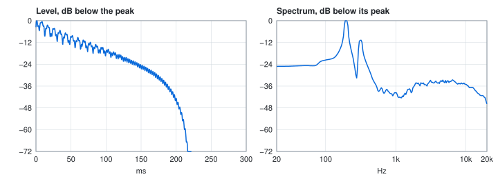

[Listen to tone](audio/tone.wav) · `halyard init tone > tone.toml`

```
tuning   196.000 Hz, G3 +0.0 cents; modes 196.0, 312.2 Hz
length   220.0 ms source, 221.9 ms exported (10651 samples at 48000 Hz, float32), seed 1
peak     -9.13 dBFS sample, -8.61 dBTP true
loudness -27.0 LUFS, the largest 400 ms momentary loudness (BS.1770)
domain   inside the validated domain: predicted aliasing -162 dB, margin 62.3 dB
         mostly kinks, 42% at body.amp[2] (0.3 ms); drive headroom +27.9 dB
```

<details><summary>The patch</summary>

```toml
instrument = "snare"
schema = 1
seed = 1

[body]
tune_hz  = 196.0
level_db = -3.0
damping  = 1.0              # mode i decays ratio^damping times faster
modes = [                   # loudest mode exactly 0 dB
  { ratio = 1.0,   level_db = 0.0 },
  { ratio = 1.593, level_db = -6.0 },
]
pitch = [                   # ratio to tune_hz; starts at 0 ms, ends at 1
  { ms = 0.0,  ratio = 1.06 },
  { ms = 12.0, ratio = 1.0 },
]
amp = [                     # shape: 0 at both ends, highest point exactly 1
  { ms = 0.0,   gain = 0.0 },
  { ms = 0.3,   gain = 1.0 },
  { ms = 20.0,  gain = 0.6 },
  { ms = 70.0,  gain = 0.25 },
  { ms = 160.0, gain = 0.05 },
  { ms = 220.0, gain = 0.0 },
]

[[noise]]                   # noise[1]
level_db = -18.0
band_hz  = [1000.0, 12000.0]
rattle   = 0.0              # 0 … 1, gated at the body's fundamental
amp = [
  { ms = 0.0,  gain = 0.0 },
  { ms = 0.15, gain = 1.0 },
  { ms = 0.3,  gain = 0.6 },
  { ms = 3.0,  gain = 0.1 },
  { ms = 8.0,  gain = 0.0 },
]

[[noise]]                   # noise[2]
level_db = -9.0
band_hz  = [2000.0, 11000.0]
rattle   = 0.2              # 0 … 1, gated at the body's fundamental
amp = [
  { ms = 0.0,   gain = 0.0 },
  { ms = 1.0,   gain = 1.0 },
  { ms = 30.0,  gain = 0.4 },
  { ms = 110.0, gain = 0.1 },
  { ms = 200.0, gain = 0.0 },
]

[drive]
db = 2.0                    # small-signal gain; 0 = bypass

[output]
sample_rate = 48000
format      = "float32"     # "float32" | "pcm24" | "pcm16"
mode        = "gain"        # "gain" | "peak" | "true-peak"
db          = -11.1         # gain in dB, or peak target in dBFS
polarity    = 1
```

</details>

## crack

A 1.15 glide, three modes, a 0.03 ms click to 18 kHz, and wires to 140 ms. Try: the stick's level and rise, `stretch`.

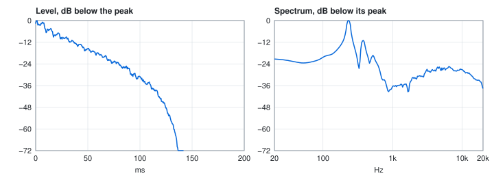

[Listen to crack](audio/crack.wav) · `halyard init crack > crack.toml`

```
tuning   233.000 Hz, A#3 -0.6 cents; modes 233.0, 371.2, 497.7 Hz
length   140.0 ms source, 141.9 ms exported (6811 samples at 48000 Hz, float32), seed 1
peak     -7.92 dBFS sample, -7.47 dBTP true
loudness -27.0 LUFS, the largest 400 ms momentary loudness (BS.1770)
domain   inside the validated domain: predicted aliasing -128 dB, margin 28.3 dB
         mostly kinks, 58% at noise[1].amp[2] (0.03 ms); drive headroom +24.9 dB
```

<details><summary>The patch</summary>

```toml
instrument = "snare"
schema = 1
seed = 1

[body]
tune_hz  = 233.0
level_db = -4.0
damping  = 1.2              # mode i decays ratio^damping times faster
modes = [                   # loudest mode exactly 0 dB
  { ratio = 1.0,   level_db = 0.0 },
  { ratio = 1.593, level_db = -5.0 },
  { ratio = 2.136, level_db = -10.0 },
]
pitch = [                   # ratio to tune_hz; starts at 0 ms, ends at 1
  { ms = 0.0, ratio = 1.15 },
  { ms = 6.0, ratio = 1.0 },
]
amp = [                     # shape: 0 at both ends, highest point exactly 1
  { ms = 0.0,   gain = 0.0 },
  { ms = 0.25,  gain = 1.0 },
  { ms = 12.0,  gain = 0.45 },
  { ms = 45.0,  gain = 0.12 },
  { ms = 110.0, gain = 0.0 },
]

[[noise]]                   # noise[1]
level_db = -8.0
band_hz  = [1500.0, 18000.0]
rattle   = 0.0              # 0 … 1, gated at the body's fundamental
amp = [
  { ms = 0.0,  gain = 0.0 },
  { ms = 0.03, gain = 1.0 },
  { ms = 0.1,  gain = 0.6 },
  { ms = 1.5,  gain = 0.12 },
  { ms = 5.0,  gain = 0.0 },
]

[[noise]]                   # noise[2]
level_db = -7.0
band_hz  = [3000.0, 12000.0]
rattle   = 0.35             # 0 … 1, gated at the body's fundamental
amp = [
  { ms = 0.0,   gain = 0.0 },
  { ms = 0.8,   gain = 1.0 },
  { ms = 18.0,  gain = 0.45 },
  { ms = 70.0,  gain = 0.1 },
  { ms = 140.0, gain = 0.0 },
]

[drive]
db = 4.0                    # small-signal gain; 0 = bypass

[output]
sample_rate = 48000
format      = "float32"     # "float32" | "pcm24" | "pcm16"
mode        = "gain"        # "gain" | "peak" | "true-peak"
db          = -9.6          # gain in dB, or peak target in dBFS
polarity    = 1
```

</details>

## fat

Three modes at 165 Hz, wires to 160 ms with rattle 0.6, and a layer below 5.5 kHz to 420 ms. Try: rattle, the low
layer's band and length.

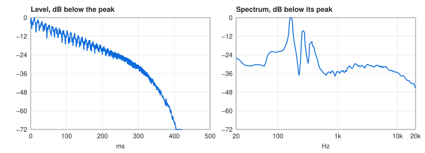

[Listen to fat](audio/fat.wav) · `halyard init fat > fat.toml`

```
tuning   165.000 Hz, E3 +2.0 cents; modes 165.0, 262.8, 352.4, 378.7 Hz
length   420.0 ms source, 421.9 ms exported (20251 samples at 48000 Hz, float32), seed 1
peak     -11.92 dBFS sample, -11.62 dBTP true
loudness -27.0 LUFS, the largest 400 ms momentary loudness (BS.1770)
domain   inside the validated domain: predicted aliasing -141 dB, margin 41.2 dB
         mostly kinks, 66% at noise[1].amp[2] (0.05 ms); drive headroom +22.7 dB
```

<details><summary>The patch</summary>

```toml
instrument = "snare"
schema = 1
seed = 1

[body]
tune_hz  = 165.0
level_db = -2.0
damping  = 0.8              # mode i decays ratio^damping times faster
modes = [                   # loudest mode exactly 0 dB
  { ratio = 1.0,   level_db = 0.0 },
  { ratio = 1.593, level_db = -4.0 },
  { ratio = 2.136, level_db = -9.0 },
  { ratio = 2.295, level_db = -12.0 },
]
pitch = [                   # ratio to tune_hz; starts at 0 ms, ends at 1
  { ms = 0.0,  ratio = 1.1 },
  { ms = 4.0,  ratio = 1.03 },
  { ms = 25.0, ratio = 1.0 },
]
amp = [                     # shape: 0 at both ends, highest point exactly 1
  { ms = 0.0,   gain = 0.0 },
  { ms = 0.5,   gain = 1.0 },
  { ms = 30.0,  gain = 0.6 },
  { ms = 110.0, gain = 0.25 },
  { ms = 260.0, gain = 0.05 },
  { ms = 380.0, gain = 0.0 },
]

[[noise]]                   # noise[1]
level_db = -12.0
band_hz  = [1200.0, 14000.0]
rattle   = 0.0              # 0 … 1, gated at the body's fundamental
amp = [
  { ms = 0.0,  gain = 0.0 },
  { ms = 0.05, gain = 1.0 },
  { ms = 0.15, gain = 0.7 },
  { ms = 3.0,  gain = 0.1 },
  { ms = 8.0,  gain = 0.0 },
]

[[noise]]                   # noise[2]
level_db = -8.0
band_hz  = [3500.0, 13000.0]
rattle   = 0.6              # 0 … 1, gated at the body's fundamental
amp = [
  { ms = 0.0,   gain = 0.0 },
  { ms = 1.2,   gain = 1.0 },
  { ms = 25.0,  gain = 0.4 },
  { ms = 90.0,  gain = 0.08 },
  { ms = 160.0, gain = 0.0 },
]

[[noise]]                   # noise[3]
level_db = -10.0
band_hz  = [1200.0, 5500.0]
rattle   = 0.7              # 0 … 1, gated at the body's fundamental
amp = [
  { ms = 0.0,   gain = 0.0 },
  { ms = 3.0,   gain = 1.0 },
  { ms = 60.0,  gain = 0.5 },
  { ms = 200.0, gain = 0.12 },
  { ms = 420.0, gain = 0.0 },
]

[drive]
db = 3.0                    # small-signal gain; 0 = bypass

[output]
sample_rate = 48000
format      = "float32"     # "float32" | "pcm24" | "pcm16"
mode        = "gain"        # "gain" | "peak" | "true-peak"
db          = -15.3         # gain in dB, or peak target in dBFS
polarity    = 1
```

</details>

## driven

12 dB of drive over three modes and wires to 200 ms. Try: drive, the wires' level.

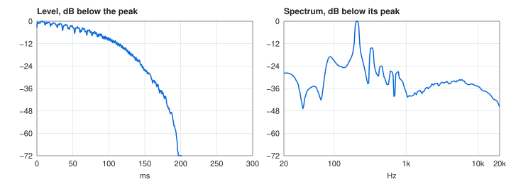

[Listen to driven](audio/driven.wav) · `halyard init driven > driven.toml`

```
tuning   208.000 Hz, G#3 +2.9 cents; modes 208.0, 331.3, 444.3 Hz
length   200.0 ms source, 201.9 ms exported (9691 samples at 48000 Hz, float32), seed 1
peak     -13.96 dBFS sample, -13.68 dBTP true
loudness -27.0 LUFS, the largest 400 ms momentary loudness (BS.1770)
domain   inside the validated domain: predicted aliasing -132 dB, margin 32.1 dB
         mostly kinks, 53% at noise[1].amp[2] (0.04 ms); drive headroom +18.1 dB
```

<details><summary>The patch</summary>

```toml
instrument = "snare"
schema = 1
seed = 1

[body]
tune_hz  = 208.0
level_db = 0.0
damping  = 1.0              # mode i decays ratio^damping times faster
modes = [                   # loudest mode exactly 0 dB
  { ratio = 1.0,   level_db = 0.0 },
  { ratio = 1.593, level_db = -6.0 },
  { ratio = 2.136, level_db = -12.0 },
]
pitch = [                   # ratio to tune_hz; starts at 0 ms, ends at 1
  { ms = 0.0, ratio = 1.12 },
  { ms = 8.0, ratio = 1.0 },
]
amp = [                     # shape: 0 at both ends, highest point exactly 1
  { ms = 0.0,   gain = 0.0 },
  { ms = 0.3,   gain = 1.0 },
  { ms = 18.0,  gain = 0.55 },
  { ms = 70.0,  gain = 0.2 },
  { ms = 170.0, gain = 0.0 },
]

[[noise]]                   # noise[1]
level_db = -10.0
band_hz  = [1500.0, 16000.0]
rattle   = 0.0              # 0 … 1, gated at the body's fundamental
amp = [
  { ms = 0.0,  gain = 0.0 },
  { ms = 0.04, gain = 1.0 },
  { ms = 0.14, gain = 0.7 },
  { ms = 2.0,  gain = 0.1 },
  { ms = 6.0,  gain = 0.0 },
]

[[noise]]                   # noise[2]
level_db = -6.0
band_hz  = [2500.0, 9000.0]
rattle   = 0.4              # 0 … 1, gated at the body's fundamental
amp = [
  { ms = 0.0,   gain = 0.0 },
  { ms = 1.0,   gain = 1.0 },
  { ms = 30.0,  gain = 0.45 },
  { ms = 100.0, gain = 0.1 },
  { ms = 200.0, gain = 0.0 },
]

[drive]
db = 12.0                   # small-signal gain; 0 = bypass

[output]
sample_rate = 48000
format      = "float32"     # "float32" | "pcm24" | "pcm16"
mode        = "gain"        # "gain" | "peak" | "true-peak"
db          = -17.5         # gain in dB, or peak target in dBFS
polarity    = 1
```

</details>

## clap

A train of four bursts at 0.9–3.2 kHz and a 0.7–6 kHz tail to 220 ms, with no body. Try: `bursts`, the bands, the tail
layer.

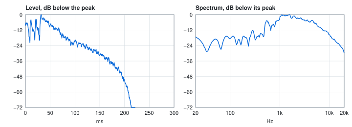

[Listen to clap](audio/clap.wav) · `halyard init clap > clap.toml`

```
tuning   200.000 Hz, G3 +35.0 cents (the body is silent)
length   220.0 ms source, 221.9 ms exported (10651 samples at 48000 Hz, float32), seed 1
peak     -9.28 dBFS sample, -9.26 dBTP true
loudness -27.0 LUFS, the largest 400 ms momentary loudness (BS.1770)
domain   inside the validated domain: predicted aliasing -136 dB, margin 36.5 dB
         mostly kinks, 29% at noise[1].amp[10] (30 ms); drive headroom +28.9 dB
```

<details><summary>The patch</summary>

```toml
instrument = "snare"
schema = 1
seed = 1

[body]
tune_hz  = 200.0
level_db = -inf
damping  = 1.0              # mode i decays ratio^damping times faster
modes = [                   # loudest mode exactly 0 dB
  { ratio = 1.0, level_db = 0.0 },
]
pitch = [                   # ratio to tune_hz; starts at 0 ms, ends at 1
  { ms = 0.0,  ratio = 1.0 },
  { ms = 10.0, ratio = 1.0 },
]
amp = [                     # shape: 0 at both ends, highest point exactly 1
  { ms = 0.0,  gain = 0.0 },
  { ms = 1.0,  gain = 1.0 },
  { ms = 50.0, gain = 0.0 },
]

[[noise]]                   # noise[1]
level_db = -4.0
band_hz  = [900.0, 3200.0]
rattle   = 0.0              # 0 … 1, gated at the body's fundamental
amp = [
  { ms = 0.0,    gain = 0.0 },
  { ms = 0.1,    gain = 1.0 },
  { ms = 0.2,    gain = 0.977 },
  { ms = 10.0,   gain = 0.1 },
  { ms = 10.1,   gain = 1.0 },
  { ms = 10.2,   gain = 0.977 },
  { ms = 20.0,   gain = 0.1 },
  { ms = 20.1,   gain = 1.0 },
  { ms = 20.2,   gain = 0.977 },
  { ms = 30.0,   gain = 0.1 },
  { ms = 30.1,   gain = 1.0 },
  { ms = 30.2,   gain = 0.9902 },
  { ms = 53.433, gain = 0.1 },
  { ms = 100.1,  gain = 0.0 },
]

[[noise]]                   # noise[2]
level_db = -12.0
band_hz  = [700.0, 6000.0]
rattle   = 0.0              # 0 … 1, gated at the body's fundamental
amp = [
  { ms = 0.0,   gain = 0.0 },
  { ms = 28.0,  gain = 0.0 },
  { ms = 33.0,  gain = 1.0 },
  { ms = 90.0,  gain = 0.3 },
  { ms = 220.0, gain = 0.0 },
]

[drive]
db = 2.0                    # small-signal gain; 0 = bypass

[output]
sample_rate = 48000
format      = "float32"     # "float32" | "pcm24" | "pcm16"
mode        = "gain"        # "gain" | "peak" | "true-peak"
db          = -11.7         # gain in dB, or peak target in dBFS
polarity    = 1
```

</details>

## snap

One mode at 1.8 kHz and a 20 ms burst at 2–14 kHz, undriven. Try: the mode's tuning, the burst's band.

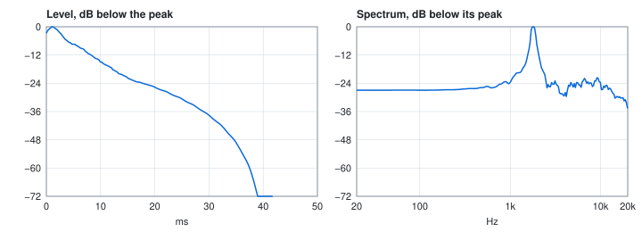

[Listen to snap](audio/snap.wav) · `halyard init snap > snap.toml`

```
tuning   1800.000 Hz, A6 +38.9 cents; modes 1800.0 Hz
length   40.0 ms source, 41.9 ms exported (2011 samples at 48000 Hz, float32), seed 1
peak     -2.03 dBFS sample, -2.03 dBTP true
loudness -27.0 LUFS, the largest 400 ms momentary loudness (BS.1770)
domain   inside the validated domain: predicted aliasing -135 dB, margin 34.9 dB
         mostly kinks, 53% at noise[1].amp[2] (0.05 ms); drive headroom +30.4 dB
```

<details><summary>The patch</summary>

```toml
instrument = "snare"
schema = 1
seed = 1

[body]
tune_hz  = 1800.0
level_db = -2.0
damping  = 1.0              # mode i decays ratio^damping times faster
modes = [                   # loudest mode exactly 0 dB
  { ratio = 1.0, level_db = 0.0 },
]
pitch = [                   # ratio to tune_hz; starts at 0 ms, ends at 1
  { ms = 0.0, ratio = 1.02 },
  { ms = 3.0, ratio = 1.0 },
]
amp = [                     # shape: 0 at both ends, highest point exactly 1
  { ms = 0.0,  gain = 0.0 },
  { ms = 0.1,  gain = 1.0 },
  { ms = 4.0,  gain = 0.4 },
  { ms = 15.0, gain = 0.08 },
  { ms = 40.0, gain = 0.0 },
]

[[noise]]                   # noise[1]
level_db = -6.0
band_hz  = [2000.0, 14000.0]
rattle   = 0.0              # 0 … 1, gated at the body's fundamental
amp = [
  { ms = 0.0,  gain = 0.0 },
  { ms = 0.05, gain = 1.0 },
  { ms = 0.15, gain = 0.7 },
  { ms = 6.0,  gain = 0.25 },
  { ms = 20.0, gain = 0.0 },
]

[drive]
db = 0.0                    # small-signal gain; 0 = bypass

[output]
sample_rate = 48000
format      = "float32"     # "float32" | "pcm24" | "pcm16"
mode        = "gain"        # "gain" | "peak" | "true-peak"
db          = -3.7          # gain in dB, or peak target in dBFS
polarity    = 1
```

</details>

## machine

Two modes, 1 and 1.83 times 180 Hz, and noise at 1.8–14 kHz to 190 ms; no wires, a 1.02 glide. Try: the second mode's
ratio and level, the noise's length.

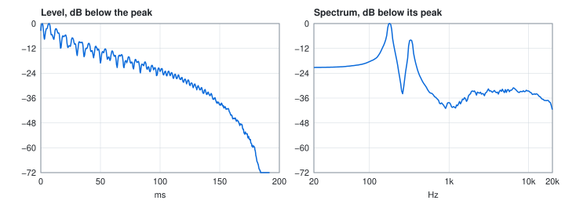

[Listen to machine](audio/machine.wav) · `halyard init machine > machine.toml`

```
tuning   180.000 Hz, F#3 -47.4 cents; modes 180.0, 329.4 Hz
length   190.0 ms source, 191.9 ms exported (9211 samples at 48000 Hz, float32), seed 1
peak     -5.64 dBFS sample, -4.77 dBTP true
loudness -27.0 LUFS, the largest 400 ms momentary loudness (BS.1770)
domain   inside the validated domain: predicted aliasing -169 dB, margin 69.0 dB
         mostly kinks, 76% at body.amp[2] (0.3 ms); drive headroom +29.3 dB
```

<details><summary>The patch</summary>

```toml
instrument = "snare"
schema = 1
seed = 1

[body]
tune_hz  = 180.0
level_db = -3.0
damping  = 0.6              # mode i decays ratio^damping times faster
modes = [                   # loudest mode exactly 0 dB
  { ratio = 1.0,  level_db = 0.0 },
  { ratio = 1.83, level_db = -4.0 },
]
pitch = [                   # ratio to tune_hz; starts at 0 ms, ends at 1
  { ms = 0.0, ratio = 1.02 },
  { ms = 4.0, ratio = 1.0 },
]
amp = [                     # shape: 0 at both ends, highest point exactly 1
  { ms = 0.0,   gain = 0.0 },
  { ms = 0.3,   gain = 1.0 },
  { ms = 25.0,  gain = 0.45 },
  { ms = 90.0,  gain = 0.12 },
  { ms = 170.0, gain = 0.0 },
]

[[noise]]                   # noise[1]
level_db = -9.0
band_hz  = [1800.0, 14000.0]
rattle   = 0.0              # 0 … 1, gated at the body's fundamental
amp = [
  { ms = 0.0,   gain = 0.0 },
  { ms = 0.6,   gain = 1.0 },
  { ms = 30.0,  gain = 0.4 },
  { ms = 110.0, gain = 0.1 },
  { ms = 190.0, gain = 0.0 },
]

[drive]
db = 0.0                    # small-signal gain; 0 = bypass

[output]
sample_rate = 48000
format      = "float32"     # "float32" | "pcm24" | "pcm16"
mode        = "gain"        # "gain" | "peak" | "true-peak"
db          = -9.8          # gain in dB, or peak target in dBFS
polarity    = 1
```

</details>

## house

Two modes with a 1.12 glide, noise at 2.5–15 kHz to 260 ms that outlasts them, and 6 dB of drive. Try: drive, the glide,
the noise's length.

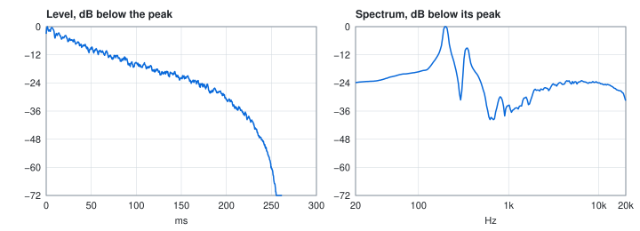

[Listen to house](audio/house.wav) · `halyard init house > house.toml`

```
tuning   200.000 Hz, G3 +35.0 cents; modes 200.0, 340.0 Hz
length   260.0 ms source, 261.9 ms exported (12571 samples at 48000 Hz, float32), seed 1
peak     -10.82 dBFS sample, -10.26 dBTP true
loudness -27.0 LUFS, the largest 400 ms momentary loudness (BS.1770)
domain   inside the validated domain: predicted aliasing -140 dB, margin 40.5 dB
         mostly kinks, 67% at noise[1].amp[2] (0.05 ms); drive headroom +20.2 dB
```

<details><summary>The patch</summary>

```toml
instrument = "snare"
schema = 1
seed = 1

[body]
tune_hz  = 200.0
level_db = -4.0
damping  = 1.0              # mode i decays ratio^damping times faster
modes = [                   # loudest mode exactly 0 dB
  { ratio = 1.0, level_db = 0.0 },
  { ratio = 1.7, level_db = -3.0 },
]
pitch = [                   # ratio to tune_hz; starts at 0 ms, ends at 1
  { ms = 0.0, ratio = 1.12 },
  { ms = 8.0, ratio = 1.0 },
]
amp = [                     # shape: 0 at both ends, highest point exactly 1
  { ms = 0.0,   gain = 0.0 },
  { ms = 0.25,  gain = 1.0 },
  { ms = 15.0,  gain = 0.4 },
  { ms = 60.0,  gain = 0.1 },
  { ms = 120.0, gain = 0.0 },
]

[[noise]]                   # noise[1]
level_db = -12.0
band_hz  = [2000.0, 16000.0]
rattle   = 0.0              # 0 … 1, gated at the body's fundamental
amp = [
  { ms = 0.0,  gain = 0.0 },
  { ms = 0.05, gain = 1.0 },
  { ms = 0.2,  gain = 0.5 },
  { ms = 2.0,  gain = 0.08 },
  { ms = 6.0,  gain = 0.0 },
]

[[noise]]                   # noise[2]
level_db = -7.0
band_hz  = [2500.0, 15000.0]
rattle   = 0.0              # 0 … 1, gated at the body's fundamental
amp = [
  { ms = 0.0,   gain = 0.0 },
  { ms = 0.4,   gain = 1.0 },
  { ms = 40.0,  gain = 0.45 },
  { ms = 140.0, gain = 0.12 },
  { ms = 260.0, gain = 0.0 },
]

[drive]
db = 6.0                    # small-signal gain; 0 = bypass

[output]
sample_rate = 48000
format      = "float32"     # "float32" | "pcm24" | "pcm16"
mode        = "gain"        # "gain" | "peak" | "true-peak"
db          = -14.1         # gain in dB, or peak target in dBFS
polarity    = 1
```

</details>

## short-clap

A train of bursts at 0.9–5 kHz to 74 ms and a tail to 90 ms, undriven. Try: `bursts`, the tail layer.

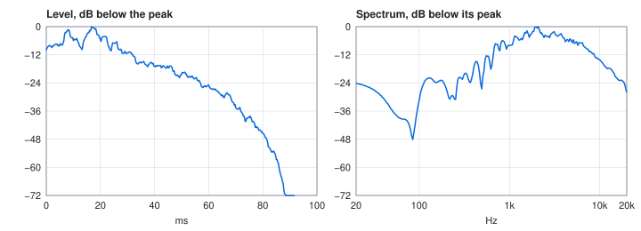

[Listen to short-clap](audio/short-clap.wav) · `halyard init short-clap > short-clap.toml`

```
tuning   185.000 Hz, F#3 +0.0 cents (the body is silent)
length   90.0 ms source, 91.9 ms exported (4411 samples at 48000 Hz, float32), seed 1
peak     -4.82 dBFS sample, -4.80 dBTP true
loudness -27.0 LUFS, the largest 400 ms momentary loudness (BS.1770)
domain   inside the validated domain: predicted aliasing -142 dB, margin 42.5 dB
         mostly kinks, 20% at noise[1].amp[1] (0 ms); drive headroom +31.3 dB
```

<details><summary>The patch</summary>

```toml
instrument = "snare"
schema = 1
seed = 1

[body]
tune_hz  = 185.0
level_db = -inf
damping  = 1.0              # mode i decays ratio^damping times faster
modes = [                   # loudest mode exactly 0 dB
  { ratio = 1.0, level_db = 0.0 },
]
pitch = [                   # ratio to tune_hz; starts at 0 ms, ends at 1
  { ms = 0.0, ratio = 1.0 },
  { ms = 5.0, ratio = 1.0 },
]
amp = [                     # shape: 0 at both ends, highest point exactly 1
  { ms = 0.0, gain = 0.0 },
  { ms = 0.5, gain = 1.0 },
  { ms = 5.0, gain = 0.0 },
]

[[noise]]                   # noise[1]
level_db = -6.0
band_hz  = [900.0, 5000.0]
rattle   = 0.0              # 0 … 1, gated at the body's fundamental
amp = [
  { ms = 0.0,  gain = 0.0 },
  { ms = 0.1,  gain = 1.0 },
  { ms = 0.2,  gain = 0.9672 },
  { ms = 7.0,  gain = 0.1 },
  { ms = 7.1,  gain = 1.0 },
  { ms = 7.2,  gain = 0.9672 },
  { ms = 14.0, gain = 0.1 },
  { ms = 14.1, gain = 1.0 },
  { ms = 14.2, gain = 0.9886 },
  { ms = 34.1, gain = 0.1 },
  { ms = 74.1, gain = 0.0 },
]

[[noise]]                   # noise[2]
level_db = -10.0
band_hz  = [1000.0, 6000.0]
rattle   = 0.0              # 0 … 1, gated at the body's fundamental
amp = [
  { ms = 0.0,  gain = 0.0 },
  { ms = 8.0,  gain = 1.0 },
  { ms = 35.0, gain = 0.35 },
  { ms = 90.0, gain = 0.0 },
]

[drive]
db = 0.0                    # small-signal gain; 0 = bypass

[output]
sample_rate = 48000
format      = "float32"     # "float32" | "pcm24" | "pcm16"
mode        = "gain"        # "gain" | "peak" | "true-peak"
db          = -9.2          # gain in dB, or peak target in dBFS
polarity    = 1
```

</details>

## rim-click

A rim's two modes, 455 Hz and 1.67 kHz, and a 3 ms tick; no head. Try: the rim's two frequencies, `stretch`.

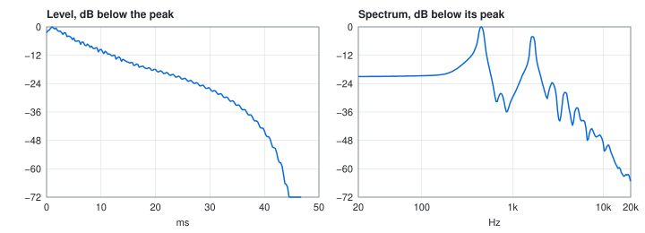

[Listen to rim-click](audio/rim-click.wav) · `halyard init rim-click > rim-click.toml`

```
tuning   185.000 Hz, F#3 +0.0 cents (the body is silent); rim 1 455.0, 1667.0 Hz
length   45.0 ms source, 46.9 ms exported (2251 samples at 48000 Hz, float32), seed 1
peak     -5.10 dBFS sample, -5.09 dBTP true
loudness -27.0 LUFS, the largest 400 ms momentary loudness (BS.1770)
domain   inside the validated domain: predicted aliasing -133 dB, margin 32.8 dB
         mostly kinks, 54% at noise[1].amp[2] (0.03 ms); drive headroom +38.6 dB
```

<details><summary>The patch</summary>

```toml
instrument = "snare"
schema = 1
seed = 1

[body]
tune_hz  = 185.0
level_db = -inf
damping  = 1.0              # mode i decays ratio^damping times faster
modes = [                   # loudest mode exactly 0 dB
  { ratio = 1.0, level_db = 0.0 },
]
pitch = [                   # ratio to tune_hz; starts at 0 ms, ends at 1
  { ms = 0.0, ratio = 1.0 },
  { ms = 5.0, ratio = 1.0 },
]
amp = [                     # shape: 0 at both ends, highest point exactly 1
  { ms = 0.0, gain = 0.0 },
  { ms = 0.5, gain = 1.0 },
  { ms = 5.0, gain = 0.0 },
]

[[noise]]                   # noise[1]
level_db = -16.0
band_hz  = [2000.0, 16000.0]
rattle   = 0.0              # 0 … 1, gated at the body's fundamental
amp = [
  { ms = 0.0,  gain = 0.0 },
  { ms = 0.03, gain = 1.0 },
  { ms = 0.1,  gain = 0.4 },
  { ms = 1.0,  gain = 0.05 },
  { ms = 3.0,  gain = 0.0 },
]

[[rim]]                     # rim[1]: the modes of the hoop and the stick, in Hz
level_db = -2.0
damping  = 0.6              # mode i decays (hz_i / hz_1)^damping times faster
modes = [                   # loudest mode exactly 0 dB
  { hz = 455.0,  level_db = -5.0 },
  { hz = 1667.0, level_db = 0.0 },
]
amp = [
  { ms = 0.0,  gain = 0.0 },
  { ms = 0.08, gain = 1.0 },
  { ms = 5.0,  gain = 0.45 },
  { ms = 18.0, gain = 0.15 },
  { ms = 45.0, gain = 0.0 },
]

[drive]
db = 6.0                    # small-signal gain; 0 = bypass

[output]
sample_rate = 48000
format      = "float32"     # "float32" | "pcm24" | "pcm16"
mode        = "gain"        # "gain" | "peak" | "true-peak"
db          = -5.3          # gain in dB, or peak target in dBFS
polarity    = 1
```

</details>

## big-clap

Two trains, at 0.8–2.6 kHz and 1.5–6 kHz, the second starting later, over a tail to 420 ms. Try: the trains' `--start`
and bands, the tail.

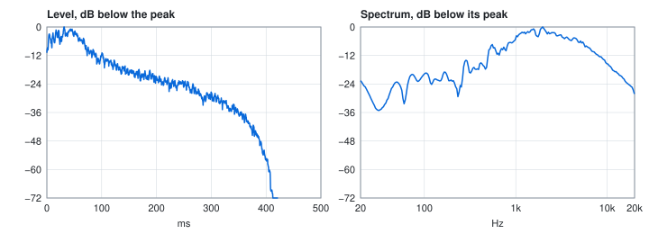

[Listen to big-clap](audio/big-clap.wav) · `halyard init big-clap > big-clap.toml`

```
tuning   185.000 Hz, F#3 +0.0 cents (the body is silent)
length   420.0 ms source, 421.9 ms exported (20251 samples at 48000 Hz, float32), seed 1
peak     -13.92 dBFS sample, -13.75 dBTP true
loudness -27.0 LUFS, the largest 400 ms momentary loudness (BS.1770)
domain   inside the validated domain: predicted aliasing -133 dB, margin 33.2 dB
         mostly kinks, 18% at noise[2].amp[2] (3 ms); drive headroom +25.0 dB
```

<details><summary>The patch</summary>

```toml
instrument = "snare"
schema = 1
seed = 1

[body]
tune_hz  = 185.0
level_db = -inf
damping  = 1.0              # mode i decays ratio^damping times faster
modes = [                   # loudest mode exactly 0 dB
  { ratio = 1.0, level_db = 0.0 },
]
pitch = [                   # ratio to tune_hz; starts at 0 ms, ends at 1
  { ms = 0.0, ratio = 1.0 },
  { ms = 5.0, ratio = 1.0 },
]
amp = [                     # shape: 0 at both ends, highest point exactly 1
  { ms = 0.0, gain = 0.0 },
  { ms = 0.5, gain = 1.0 },
  { ms = 5.0, gain = 0.0 },
]

[[noise]]                   # noise[1]
level_db = -7.0
band_hz  = [800.0, 2600.0]
rattle   = 0.0              # 0 … 1, gated at the body's fundamental
amp = [
  { ms = 0.0,   gain = 0.0 },
  { ms = 0.1,   gain = 1.0 },
  { ms = 0.2,   gain = 0.977 },
  { ms = 10.0,  gain = 0.1 },
  { ms = 10.1,  gain = 1.0 },
  { ms = 10.2,  gain = 0.977 },
  { ms = 20.0,  gain = 0.1 },
  { ms = 20.1,  gain = 1.0 },
  { ms = 20.2,  gain = 0.977 },
  { ms = 30.0,  gain = 0.1 },
  { ms = 30.1,  gain = 1.0 },
  { ms = 30.2,  gain = 0.9943 },
  { ms = 70.1,  gain = 0.1 },
  { ms = 150.1, gain = 0.0 },
]

[[noise]]                   # noise[2]
level_db = -9.0
band_hz  = [1500.0, 6000.0]
rattle   = 0.0              # 0 … 1, gated at the body's fundamental
amp = [
  { ms = 0.0,    gain = 0.0 },
  { ms = 3.0,    gain = 0.0 },
  { ms = 3.1,    gain = 1.0 },
  { ms = 3.2,    gain = 0.9808 },
  { ms = 15.0,   gain = 0.1 },
  { ms = 15.1,   gain = 1.0 },
  { ms = 15.2,   gain = 0.9808 },
  { ms = 27.0,   gain = 0.1 },
  { ms = 27.1,   gain = 1.0 },
  { ms = 27.2,   gain = 0.9808 },
  { ms = 39.0,   gain = 0.1 },
  { ms = 39.1,   gain = 1.0 },
  { ms = 39.2,   gain = 0.9951 },
  { ms = 85.767, gain = 0.1 },
  { ms = 179.1,  gain = 0.0 },
]

[[noise]]                   # noise[3]
level_db = -12.0
band_hz  = [900.0, 5000.0]
rattle   = 0.0              # 0 … 1, gated at the body's fundamental
amp = [
  { ms = 0.0,   gain = 0.0 },
  { ms = 15.0,  gain = 1.0 },
  { ms = 120.0, gain = 0.4 },
  { ms = 300.0, gain = 0.1 },
  { ms = 420.0, gain = 0.0 },
]

[drive]
db = 3.0                    # small-signal gain; 0 = bypass

[output]
sample_rate = 48000
format      = "float32"     # "float32" | "pcm24" | "pcm16"
mode        = "gain"        # "gain" | "peak" | "true-peak"
db          = -16.1         # gain in dB, or peak target in dBFS
polarity    = 1
```

</details>

## long-snare

Wires to 620 ms and a layer below 4.5 kHz to 540 ms. Try: the wires' length and rattle, drive.

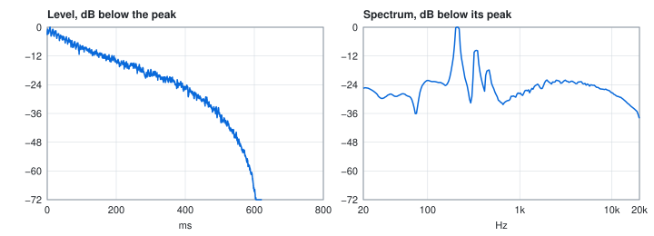

[Listen to long-snare](audio/long-snare.wav) · `halyard init long-snare > long-snare.toml`

```
tuning   210.000 Hz, G#3 +19.5 cents; modes 210.0, 334.5, 448.6 Hz
length   620.0 ms source, 621.9 ms exported (29851 samples at 48000 Hz, float32), seed 1
peak     -15.06 dBFS sample, -14.88 dBTP true
loudness -27.0 LUFS, the largest 400 ms momentary loudness (BS.1770)
domain   inside the validated domain: predicted aliasing -140 dB, margin 40.1 dB
         mostly kinks, 69% at noise[1].amp[2] (0.05 ms); drive headroom +22.7 dB
```

<details><summary>The patch</summary>

```toml
instrument = "snare"
schema = 1
seed = 1

[body]
tune_hz  = 210.0
level_db = -5.0
damping  = 1.2              # mode i decays ratio^damping times faster
modes = [                   # loudest mode exactly 0 dB
  { ratio = 1.0,   level_db = 0.0 },
  { ratio = 1.593, level_db = -4.0 },
  { ratio = 2.136, level_db = -9.0 },
]
pitch = [                   # ratio to tune_hz; starts at 0 ms, ends at 1
  { ms = 0.0,  ratio = 1.1 },
  { ms = 12.0, ratio = 1.0 },
]
amp = [                     # shape: 0 at both ends, highest point exactly 1
  { ms = 0.0,   gain = 0.0 },
  { ms = 0.4,   gain = 1.0 },
  { ms = 40.0,  gain = 0.5 },
  { ms = 160.0, gain = 0.15 },
  { ms = 320.0, gain = 0.0 },
]

[[noise]]                   # noise[1]
level_db = -12.0
band_hz  = [1500.0, 16000.0]
rattle   = 0.0              # 0 … 1, gated at the body's fundamental
amp = [
  { ms = 0.0,  gain = 0.0 },
  { ms = 0.05, gain = 1.0 },
  { ms = 0.2,  gain = 0.6 },
  { ms = 3.0,  gain = 0.1 },
  { ms = 8.0,  gain = 0.0 },
]

[[noise]]                   # noise[2]
level_db = -8.0
band_hz  = [2200.0, 11000.0]
rattle   = 0.3              # 0 … 1, gated at the body's fundamental
amp = [
  { ms = 0.0,   gain = 0.0 },
  { ms = 1.2,   gain = 1.0 },
  { ms = 60.0,  gain = 0.5 },
  { ms = 240.0, gain = 0.18 },
  { ms = 620.0, gain = 0.0 },
]

[[noise]]                   # noise[3]
level_db = -14.0
band_hz  = [900.0, 4500.0]
rattle   = 0.0              # 0 … 1, gated at the body's fundamental
amp = [
  { ms = 0.0,   gain = 0.0 },
  { ms = 3.0,   gain = 1.0 },
  { ms = 90.0,  gain = 0.4 },
  { ms = 280.0, gain = 0.12 },
  { ms = 540.0, gain = 0.0 },
]

[drive]
db = 5.0                    # small-signal gain; 0 = bypass

[output]
sample_rate = 48000
format      = "float32"     # "float32" | "pcm24" | "pcm16"
mode        = "gain"        # "gain" | "peak" | "true-peak"
db          = -17.7         # gain in dB, or peak target in dBFS
polarity    = 1
```

</details>

## rimshot

`crack`'s head with a rim of four modes from 1.24 to 7.62 kHz. Try: the rim's level and damping.

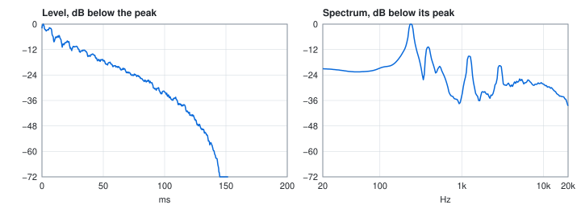

[Listen to rimshot](audio/rimshot.wav) · `halyard init rimshot > rimshot.toml`

```
tuning   240.000 Hz, B3 -49.4 cents; modes 240.0, 382.3, 512.6 Hz; rim 1 1240.0, 2930.0, 5170.0, 7620.0 Hz
length   150.0 ms source, 151.9 ms exported (7291 samples at 48000 Hz, float32), seed 1
peak     -7.30 dBFS sample, -7.13 dBTP true
loudness -27.0 LUFS, the largest 400 ms momentary loudness (BS.1770)
domain   inside the validated domain: predicted aliasing -130 dB, margin 30.3 dB
         mostly kinks, 34% at noise[1].amp[2] (0.03 ms); drive headroom +25.4 dB
```

<details><summary>The patch</summary>

```toml
instrument = "snare"
schema = 1
seed = 1

[body]
tune_hz  = 240.0
level_db = -4.0
damping  = 1.2              # mode i decays ratio^damping times faster
modes = [                   # loudest mode exactly 0 dB
  { ratio = 1.0,   level_db = 0.0 },
  { ratio = 1.593, level_db = -5.0 },
  { ratio = 2.136, level_db = -10.0 },
]
pitch = [                   # ratio to tune_hz; starts at 0 ms, ends at 1
  { ms = 0.0, ratio = 1.2 },
  { ms = 6.0, ratio = 1.0 },
]
amp = [                     # shape: 0 at both ends, highest point exactly 1
  { ms = 0.0,   gain = 0.0 },
  { ms = 0.25,  gain = 1.0 },
  { ms = 12.0,  gain = 0.45 },
  { ms = 50.0,  gain = 0.12 },
  { ms = 120.0, gain = 0.0 },
]

[[noise]]                   # noise[1]
level_db = -8.0
band_hz  = [1500.0, 18000.0]
rattle   = 0.0              # 0 … 1, gated at the body's fundamental
amp = [
  { ms = 0.0,  gain = 0.0 },
  { ms = 0.03, gain = 1.0 },
  { ms = 0.1,  gain = 0.6 },
  { ms = 1.5,  gain = 0.12 },
  { ms = 5.0,  gain = 0.0 },
]

[[noise]]                   # noise[2]
level_db = -8.0
band_hz  = [3000.0, 12000.0]
rattle   = 0.35             # 0 … 1, gated at the body's fundamental
amp = [
  { ms = 0.0,   gain = 0.0 },
  { ms = 0.8,   gain = 1.0 },
  { ms = 18.0,  gain = 0.45 },
  { ms = 70.0,  gain = 0.1 },
  { ms = 150.0, gain = 0.0 },
]

[[rim]]                     # rim[1]: the modes of the hoop and the stick, in Hz
level_db = -4.0
damping  = 1.0              # mode i decays (hz_i / hz_1)^damping times faster
modes = [                   # loudest mode exactly 0 dB
  { hz = 1240.0, level_db = -4.0 },
  { hz = 2930.0, level_db = 0.0 },
  { hz = 5170.0, level_db = -6.0 },
  { hz = 7620.0, level_db = -12.0 },
]
amp = [
  { ms = 0.0,  gain = 0.0 },
  { ms = 0.05, gain = 1.0 },
  { ms = 6.0,  gain = 0.35 },
  { ms = 30.0, gain = 0.08 },
  { ms = 70.0, gain = 0.0 },
]

[drive]
db = 3.0                    # small-signal gain; 0 = bypass

[output]
sample_rate = 48000
format      = "float32"     # "float32" | "pcm24" | "pcm16"
mode        = "gain"        # "gain" | "peak" | "true-peak"
db          = -9.3          # gain in dB, or peak target in dBFS
polarity    = 1
```

</details>

## cross-stick

A rim of four modes from 520 Hz to 4.1 kHz over a head 12 dB down. Try: the rim's damping and frequencies, the body's
level.

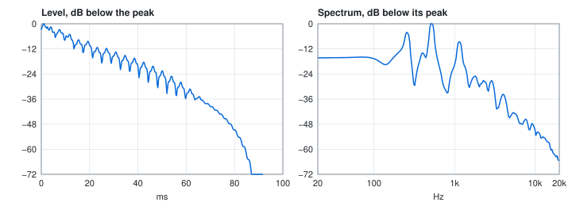

[Listen to cross-stick](audio/cross-stick.wav) · `halyard init cross-stick > cross-stick.toml`

```
tuning   260.000 Hz, C4 -10.8 cents; modes 260.0, 414.2 Hz; rim 1 520.0, 1150.0, 2380.0, 4100.0 Hz
length   90.0 ms source, 91.9 ms exported (4411 samples at 48000 Hz, float32), seed 1
peak     -6.64 dBFS sample, -6.58 dBTP true
loudness -27.0 LUFS, the largest 400 ms momentary loudness (BS.1770)
domain   inside the validated domain: predicted aliasing -142 dB, margin 41.8 dB
         mostly kinks, 60% at noise[1].amp[1] (0 ms); inside at every drive up to 48 dB
```

<details><summary>The patch</summary>

```toml
instrument = "snare"
schema = 1
seed = 1

[body]
tune_hz  = 260.0
level_db = -12.0
damping  = 1.5              # mode i decays ratio^damping times faster
modes = [                   # loudest mode exactly 0 dB
  { ratio = 1.0,   level_db = 0.0 },
  { ratio = 1.593, level_db = -6.0 },
]
pitch = [                   # ratio to tune_hz; starts at 0 ms, ends at 1
  { ms = 0.0, ratio = 1.02 },
  { ms = 4.0, ratio = 1.0 },
]
amp = [                     # shape: 0 at both ends, highest point exactly 1
  { ms = 0.0,  gain = 0.0 },
  { ms = 0.3,  gain = 1.0 },
  { ms = 10.0, gain = 0.35 },
  { ms = 40.0, gain = 0.1 },
  { ms = 90.0, gain = 0.0 },
]

[[noise]]                   # noise[1]
level_db = -16.0
band_hz  = [1200.0, 9000.0]
rattle   = 0.0              # 0 … 1, gated at the body's fundamental
amp = [
  { ms = 0.0,  gain = 0.0 },
  { ms = 0.05, gain = 1.0 },
  { ms = 0.25, gain = 0.4 },
  { ms = 2.0,  gain = 0.06 },
  { ms = 6.0,  gain = 0.0 },
]

[[rim]]                     # rim[1]: the modes of the hoop and the stick, in Hz
level_db = -2.0
damping  = 1.5              # mode i decays (hz_i / hz_1)^damping times faster
modes = [                   # loudest mode exactly 0 dB
  { hz = 520.0,  level_db = -3.0 },
  { hz = 1150.0, level_db = 0.0 },
  { hz = 2380.0, level_db = -6.0 },
  { hz = 4100.0, level_db = -14.0 },
]
amp = [
  { ms = 0.0,  gain = 0.0 },
  { ms = 0.1,  gain = 1.0 },
  { ms = 6.0,  gain = 0.5 },
  { ms = 25.0, gain = 0.15 },
  { ms = 70.0, gain = 0.0 },
]

[drive]
db = 8.0                    # small-signal gain; 0 = bypass

[output]
sample_rate = 48000
format      = "float32"     # "float32" | "pcm24" | "pcm16"
mode        = "gain"        # "gain" | "peak" | "true-peak"
db          = -7.3          # gain in dB, or peak target in dBFS
polarity    = 1
```

</details>

## brush

A 300 ms brush sweep over a head 18 dB down, and wires gated by it. Try: the sweep's knots, `stretch brush[1].sweep`.

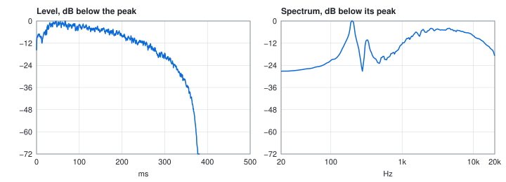

[Listen to brush](audio/brush.wav) · `halyard init brush > brush.toml`

```
tuning   200.000 Hz, G3 +35.0 cents; modes 200.0, 318.6 Hz
length   380.0 ms source, 381.9 ms exported (18331 samples at 48000 Hz, float32), seed 1
peak     -13.66 dBFS sample, -13.54 dBTP true
loudness -27.0 LUFS, the largest 400 ms momentary loudness (BS.1770)
domain   inside the validated domain: predicted aliasing -201 dB, margin 101.3 dB
         mostly kinks, 53% at body.amp[2] (1.5 ms); drive headroom +29.0 dB
```

<details><summary>The patch</summary>

```toml
instrument = "snare"
schema = 1
seed = 1

[body]
tune_hz  = 200.0
level_db = -18.0
damping  = 1.0              # mode i decays ratio^damping times faster
modes = [                   # loudest mode exactly 0 dB
  { ratio = 1.0,   level_db = 0.0 },
  { ratio = 1.593, level_db = -6.0 },
]
pitch = [                   # ratio to tune_hz; starts at 0 ms, ends at 1
  { ms = 0.0, ratio = 1.0 },
  { ms = 5.0, ratio = 1.0 },
]
amp = [                     # shape: 0 at both ends, highest point exactly 1
  { ms = 0.0,   gain = 0.0 },
  { ms = 1.5,   gain = 1.0 },
  { ms = 20.0,  gain = 0.4 },
  { ms = 80.0,  gain = 0.1 },
  { ms = 160.0, gain = 0.0 },
]

[[noise]]                   # noise[1]
level_db = -14.0
band_hz  = [1200.0, 8000.0]
rattle   = 0.4              # 0 … 1, gated at the body's fundamental
amp = [
  { ms = 0.0,  gain = 0.0 },
  { ms = 1.5,  gain = 1.0 },
  { ms = 12.0, gain = 0.4 },
  { ms = 40.0, gain = 0.1 },
  { ms = 90.0, gain = 0.0 },
]

[[brush]]                   # brush[1]: a noise layer whose band moves
level_db = -8.0
band_hz  = [1500.0, 9000.0] # at sweep ratio 1
rattle   = 0.3              # 0 … 1, gated at the body's fundamental
sweep = [                   # the band's edges times the ratio
  { ms = 0.0,   ratio = 0.8 },
  { ms = 140.0, ratio = 1.25 },
  { ms = 300.0, ratio = 0.9 },
]
amp = [
  { ms = 0.0,   gain = 0.0 },
  { ms = 40.0,  gain = 1.0 },
  { ms = 150.0, gain = 0.7 },
  { ms = 260.0, gain = 0.25 },
  { ms = 380.0, gain = 0.0 },
]

[drive]
db = 0.0                    # small-signal gain; 0 = bypass

[output]
sample_rate = 48000
format      = "float32"     # "float32" | "pcm24" | "pcm16"
mode        = "gain"        # "gain" | "peak" | "true-peak"
db          = -14.2         # gain in dB, or peak target in dBFS
polarity    = 1
```

</details>

## zap

One mode falling three octaves to its tuning in 40 ms. Try: the glide's first ratio, `stretch body.pitch`.

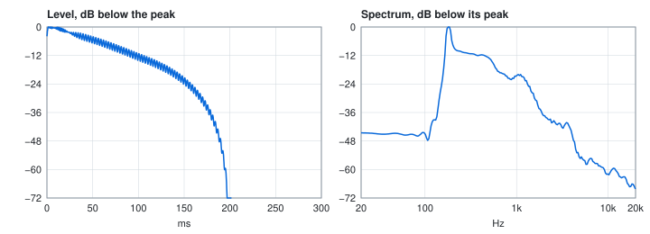

[Listen to zap](audio/zap.wav) · `halyard init zap > zap.toml`

```
tuning   180.000 Hz, F#3 -47.4 cents; modes 180.0 Hz
length   200.0 ms source, 201.9 ms exported (9691 samples at 48000 Hz, float32), seed 1
peak     -13.69 dBFS sample, -13.65 dBTP true
loudness -27.0 LUFS, the largest 400 ms momentary loudness (BS.1770)
domain   inside the validated domain: predicted aliasing -141 dB, margin 40.7 dB
         mostly kinks, 70% at noise[1].amp[2] (0.05 ms); drive headroom +35.6 dB
```

<details><summary>The patch</summary>

```toml
instrument = "snare"
schema = 1
seed = 1

[body]
tune_hz  = 180.0
level_db = -2.0
damping  = 0.0              # mode i decays ratio^damping times faster
modes = [                   # loudest mode exactly 0 dB
  { ratio = 1.0, level_db = 0.0 },
]
pitch = [                   # ratio to tune_hz; starts at 0 ms, ends at 1
  { ms = 0.0,  ratio = 8.0 },
  { ms = 6.0,  ratio = 3.0 },
  { ms = 40.0, ratio = 1.0 },
]
amp = [                     # shape: 0 at both ends, highest point exactly 1
  { ms = 0.0,   gain = 0.0 },
  { ms = 0.2,   gain = 1.0 },
  { ms = 30.0,  gain = 0.5 },
  { ms = 110.0, gain = 0.12 },
  { ms = 200.0, gain = 0.0 },
]

[[noise]]                   # noise[1]
level_db = -16.0
band_hz  = [2000.0, 16000.0]
rattle   = 0.0              # 0 … 1, gated at the body's fundamental
amp = [
  { ms = 0.0,  gain = 0.0 },
  { ms = 0.05, gain = 1.0 },
  { ms = 0.2,  gain = 0.4 },
  { ms = 2.0,  gain = 0.05 },
  { ms = 6.0,  gain = 0.0 },
]

[drive]
db = 8.0                    # small-signal gain; 0 = bypass

[output]
sample_rate = 48000
format      = "float32"     # "float32" | "pcm24" | "pcm16"
mode        = "gain"        # "gain" | "peak" | "true-peak"
db          = -14.6         # gain in dB, or peak target in dBFS
polarity    = 1
```

</details>

## reverse

Noise and a brush rising for 390 ms, the brush's band rising with it, cut at the end. Try: `stretch all` to fit the
bars, the sweep's start.

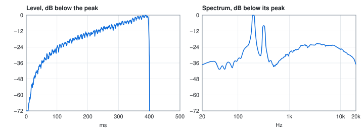

[Listen to reverse](audio/reverse.wav) · `halyard init reverse > reverse.toml`

```
tuning   200.000 Hz, G3 +35.0 cents; modes 200.0, 318.6 Hz
length   400.0 ms source, 401.9 ms exported (19291 samples at 48000 Hz, float32), seed 1
peak     -13.56 dBFS sample, -13.51 dBTP true
loudness -27.0 LUFS, the largest 400 ms momentary loudness (BS.1770)
domain   inside the validated domain: predicted aliasing -217 dB, margin 117.0 dB
         mostly kinks, 51% at body.amp[4] (394 ms); drive headroom +21.4 dB
```

<details><summary>The patch</summary>

```toml
instrument = "snare"
schema = 1
seed = 1

[body]
tune_hz  = 200.0
level_db = -8.0
damping  = 0.5              # mode i decays ratio^damping times faster
modes = [                   # loudest mode exactly 0 dB
  { ratio = 1.0,   level_db = 0.0 },
  { ratio = 1.593, level_db = -6.0 },
]
pitch = [                   # ratio to tune_hz; starts at 0 ms, ends at 1
  { ms = 0.0,  ratio = 1.0 },
  { ms = 10.0, ratio = 1.0 },
]
amp = [                     # shape: 0 at both ends, highest point exactly 1
  { ms = 0.0,   gain = 0.0 },
  { ms = 200.0, gain = 0.15 },
  { ms = 330.0, gain = 0.5 },
  { ms = 394.0, gain = 1.0 },
  { ms = 400.0, gain = 0.0 },
]

[[noise]]                   # noise[1]
level_db = -10.0
band_hz  = [2000.0, 10000.0]
rattle   = 0.2              # 0 … 1, gated at the body's fundamental
amp = [
  { ms = 0.0,   gain = 0.0 },
  { ms = 220.0, gain = 0.15 },
  { ms = 340.0, gain = 0.5 },
  { ms = 394.0, gain = 1.0 },
  { ms = 400.0, gain = 0.0 },
]

[[brush]]                   # brush[1]: a noise layer whose band moves
level_db = -10.0
band_hz  = [1200.0, 9000.0] # at sweep ratio 1
rattle   = 0.0              # 0 … 1, gated at the body's fundamental
sweep = [                   # the band's edges times the ratio
  { ms = 0.0,   ratio = 0.55 },
  { ms = 390.0, ratio = 1.05 },
]
amp = [
  { ms = 0.0,   gain = 0.0 },
  { ms = 180.0, gain = 0.15 },
  { ms = 330.0, gain = 0.55 },
  { ms = 395.0, gain = 1.0 },
  { ms = 400.0, gain = 0.0 },
]

[drive]
db = 4.0                    # small-signal gain; 0 = bypass

[output]
sample_rate = 48000
format      = "float32"     # "float32" | "pcm24" | "pcm16"
mode        = "gain"        # "gain" | "peak" | "true-peak"
db          = -17.4         # gain in dB, or peak target in dBFS
polarity    = 1
```

</details>

## closing

Two modes and a brush whose band falls an octave in 150 ms. Try: how far the sweep falls, `stretch brush[1].sweep`.

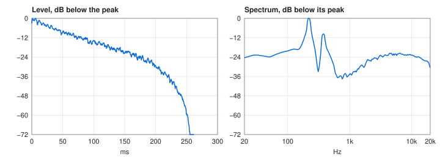

[Listen to closing](audio/closing.wav) · `halyard init closing > closing.toml`

```
tuning   220.000 Hz, A3 +0.0 cents; modes 220.0, 374.0 Hz
length   260.0 ms source, 261.9 ms exported (12571 samples at 48000 Hz, float32), seed 1
peak     -11.76 dBFS sample, -10.83 dBTP true
loudness -27.0 LUFS, the largest 400 ms momentary loudness (BS.1770)
domain   inside the validated domain: predicted aliasing -143 dB, margin 42.9 dB
         mostly kinks, 74% at noise[1].amp[2] (0.05 ms); drive headroom +19.3 dB
```

<details><summary>The patch</summary>

```toml
instrument = "snare"
schema = 1
seed = 1

[body]
tune_hz  = 220.0
level_db = -6.0
damping  = 1.0              # mode i decays ratio^damping times faster
modes = [                   # loudest mode exactly 0 dB
  { ratio = 1.0, level_db = 0.0 },
  { ratio = 1.7, level_db = -4.0 },
]
pitch = [                   # ratio to tune_hz; starts at 0 ms, ends at 1
  { ms = 0.0, ratio = 1.06 },
  { ms = 8.0, ratio = 1.0 },
]
amp = [                     # shape: 0 at both ends, highest point exactly 1
  { ms = 0.0,   gain = 0.0 },
  { ms = 0.3,   gain = 1.0 },
  { ms = 20.0,  gain = 0.4 },
  { ms = 80.0,  gain = 0.1 },
  { ms = 160.0, gain = 0.0 },
]

[[noise]]                   # noise[1]
level_db = -14.0
band_hz  = [2500.0, 16000.0]
rattle   = 0.0              # 0 … 1, gated at the body's fundamental
amp = [
  { ms = 0.0,  gain = 0.0 },
  { ms = 0.05, gain = 1.0 },
  { ms = 0.2,  gain = 0.5 },
  { ms = 2.0,  gain = 0.08 },
  { ms = 6.0,  gain = 0.0 },
]

[[brush]]                   # brush[1]: a noise layer whose band moves
level_db = -6.0
band_hz  = [3000.0, 16000.0] # at sweep ratio 1
rattle   = 0.0              # 0 … 1, gated at the body's fundamental
sweep = [                   # the band's edges times the ratio
  { ms = 0.0,   ratio = 1.0 },
  { ms = 150.0, ratio = 0.5 },
]
amp = [
  { ms = 0.0,   gain = 0.0 },
  { ms = 0.6,   gain = 1.0 },
  { ms = 40.0,  gain = 0.45 },
  { ms = 140.0, gain = 0.12 },
  { ms = 260.0, gain = 0.0 },
]

[drive]
db = 5.0                    # small-signal gain; 0 = bypass

[output]
sample_rate = 48000
format      = "float32"     # "float32" | "pcm24" | "pcm16"
mode        = "gain"        # "gain" | "peak" | "true-peak"
db          = -14.1         # gain in dB, or peak target in dBFS
polarity    = 1
```

</details>
